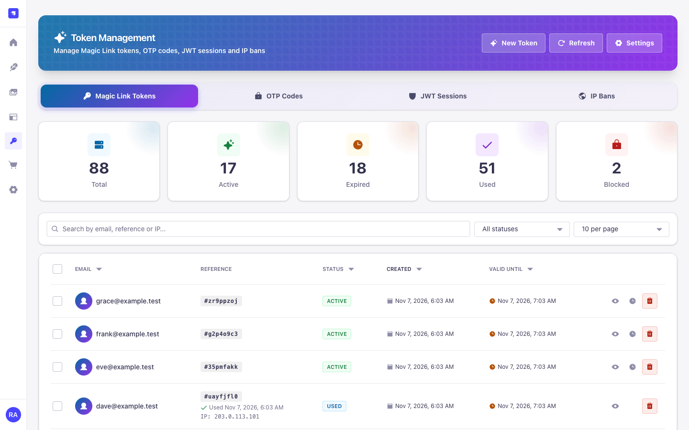
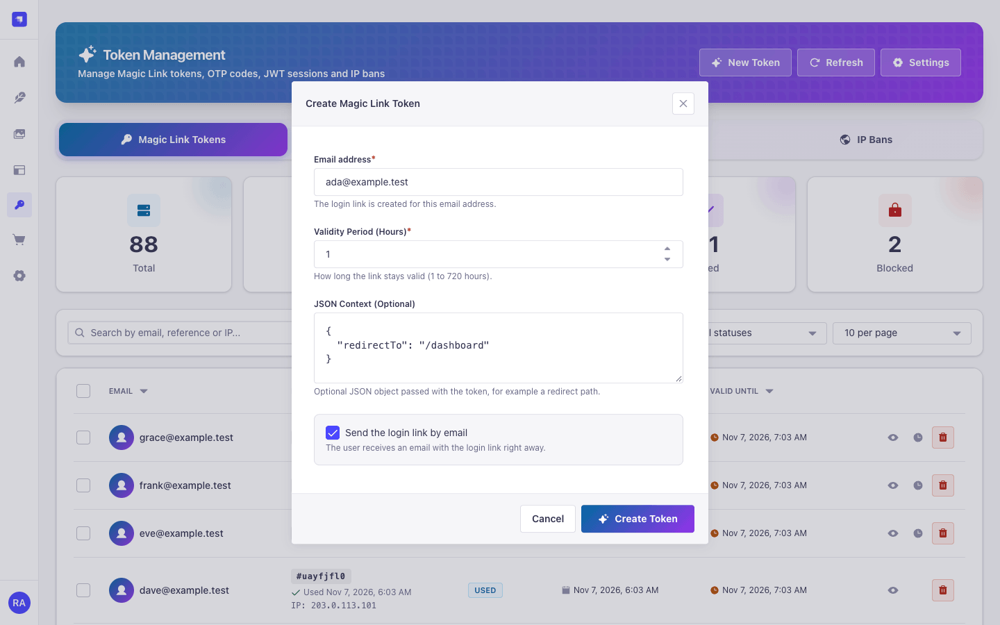
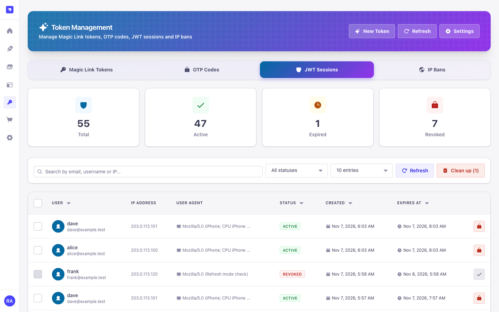
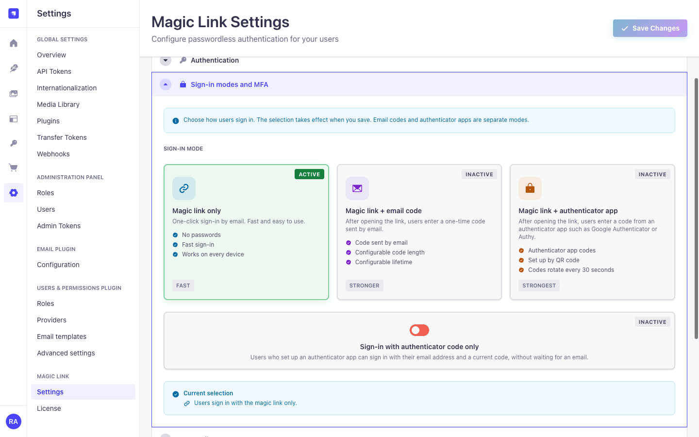
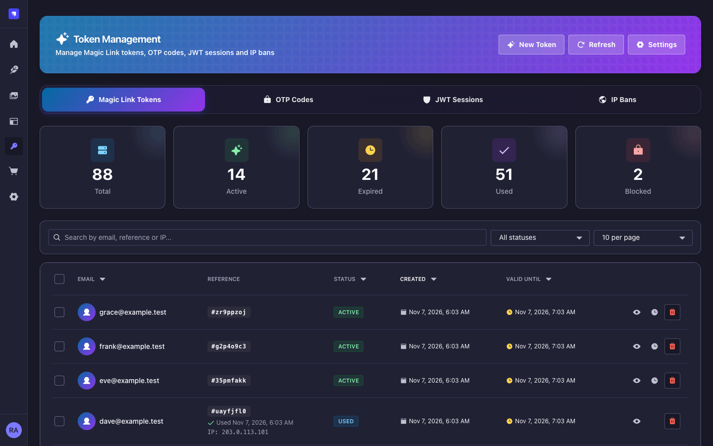
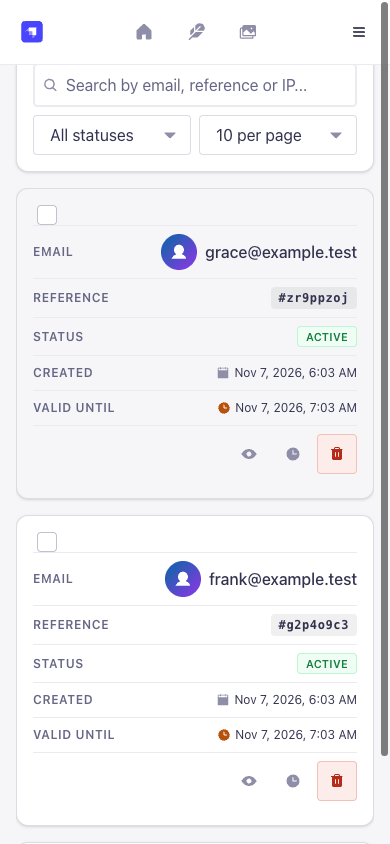

<p align="center">
  
</p>

# Magic Link for Strapi 5

Passwordless login for Strapi 5. Your users type their e-mail address, click the link in their inbox and get a normal Users & Permissions session, the same kind `/api/auth/local` creates. When a link is not enough, add a second factor: an e-mailed one-time code (OTP) or an authenticator app (TOTP) with backup codes.

[](https://www.npmjs.com/package/strapi-plugin-magic-link-v5)
[](https://www.npmjs.com/package/strapi-plugin-magic-link-v5)
[](https://github.com/Schero94/strapi-plugin-magic-link-v5/actions/workflows/release.yml?query=branch%3Amain)
[](https://github.com/Schero94/strapi-plugin-magic-link-v5/blob/main/LICENSE)
[](https://github.com/Schero94/strapi-plugin-magic-link-v5#compatibility)
[](https://schero94.github.io/strapi-plugin-magic-link-v5/)

**Live docs:** [schero94.github.io/strapi-plugin-magic-link-v5](https://schero94.github.io/strapi-plugin-magic-link-v5/) · [npm](https://www.npmjs.com/package/strapi-plugin-magic-link-v5) · [Reference](https://github.com/Schero94/strapi-plugin-magic-link-v5/blob/main/docs/reference.md) · [Changelog](https://github.com/Schero94/strapi-plugin-magic-link-v5/blob/main/CHANGELOG.md) · [Issues](https://github.com/Schero94/strapi-plugin-magic-link-v5/issues)



Free and open source (MIT). Every feature is available to every installation, and the plugin sends no telemetry and never phones home.

## In one minute

```bash
npm install strapi-plugin-magic-link-v5
echo "MAGIC_LINK_ENCRYPTION_KEY=$(node -e "console.log(require('crypto').randomBytes(32).toString('hex'))")" >> .env
echo "MAGIC_LINK_OTP_PEPPER=$(node -e "console.log(require('crypto').randomBytes(32).toString('hex'))")" >> .env
npm run build && npm run develop
```

With a Strapi e-mail provider configured, ask for a link:

```bash
curl -X POST http://localhost:1337/api/magic-link/send-link \
  -H 'Content-Type: application/json' -d '{"email":"ada@example.com"}'
```

Your landing page then posts the `loginToken` from the link to `POST /api/magic-link/login` and gets `{ jwt, user }` back. The [quick start](#quick-start-5-minutes) walks through each step, including the e-mail provider and the frontend URL.

## Contents

- [What you get](#what-you-get)
- [Screenshots](#screenshots)
- [Compatibility](#compatibility)
- [Quick start (5 minutes)](#quick-start-5-minutes)
- [Frontend integration](#frontend-integration)
- [Second factors: e-mail OTP, TOTP and backup codes](#second-factors-e-mail-otp-totp-and-backup-codes)
- [Refresh mode (users-permissions sessions)](#refresh-mode-users-permissions-sessions)
- [Public API](#public-api)
- [Permissions](#permissions)
- [Security and privacy](#security-and-privacy)
- [Reference documentation](#reference-documentation)
- [FAQ](#faq)
- [Troubleshooting](#troubleshooting)
- [Upgrading](#upgrading)
- [Showcase your company](#showcase-your-company)
- [Languages, license and support](#languages-license-and-support)

## What you get

- **Magic links by e-mail.** One API call sends the link. Your landing page exchanges it for a JWT.
- **Optional second factors.**
  - E-mail OTP after the link click.
  - Authenticator apps (TOTP) as optional or required MFA: enrolment during sign-in, self-service for logged-in users, and one-time backup codes.
  - TOTP-only login without an e-mail round trip.
- **Built for production.**
  - Links are stored hashed, expire, and a single-use link is consumed atomically.
  - Rate limits per IP and per address, IP bans, and an always-on limit for code checks.
  - A JWT session list with revocation, also for users-permissions refresh sessions.
- **Works with your stack.** Users & Permissions (legacy JWTs and refresh-token sessions), the Strapi e-mail plugin, Magic Mail, Email Designer 5, and a `strapi-plugin-passwordless` compatibility mode.
- **Admin panel.**
  - Pages for tokens, OTP codes, JWT sessions, IP bans and settings.
  - Light and dark mode, translated into English, German, French, Spanish and Portuguese.
  - Fine-grained admin permissions, enforced on the server.

Magic Link is **e-mail only**. WhatsApp and SMS delivery were removed in 6.0.0.

## Screenshots

All screenshots use synthetic data (`example.test` addresses and documentation IP ranges). The [full gallery](https://schero94.github.io/strapi-plugin-magic-link-v5/#gallery) on the docs site also shows IP bans, the general settings and the JWT sessions on a phone.

### Create a token



### JWT sessions



### Sign-in modes and MFA



### Dark mode



### On a phone

On screens 390 px wide the tables turn into cards.



## Compatibility

| Magic Link | Strapi                                    | Node.js  | Notes                                                                                                                                                    |
| ---------- | ----------------------------------------- | -------- | -------------------------------------------------------------------------------------------------------------------------------------------------------- |
| 7.x        | 5.50.0 or newer (acceptance host: 5.63.0) | 22 to 26 | No registration key, no outbound calls of its own                                                                                                        |
| 6.x        | 5.24.0 or newer                           | 22 to 26 | Security release; see [Upgrading from 5.x](https://github.com/Schero94/strapi-plugin-magic-link-v5/blob/main/docs/reference.md#upgrading-from-5x-to-600) |
| 5.x        | 5.0.0 or newer                            | 18 to 22 | Releases come from `main` only; upgrade to 7.x                                                                                                           |

What the host needs:

| Component           | Version                                                                                  |
| ------------------- | ---------------------------------------------------------------------------------------- |
| Strapi              | 5.50.0 or newer                                                                          |
| Node.js             | 22 to 26 (the range Strapi 5.63 supports)                                                |
| Users & Permissions | Installed (default in Strapi 5)                                                          |
| E-mail              | A configured Strapi e-mail provider, or Magic Mail                                       |
| Environment         | `MAGIC_LINK_ENCRYPTION_KEY` and `MAGIC_LINK_OTP_PEPPER`, 32+ characters each (see below) |
| Database            | SQLite, PostgreSQL or MySQL/MariaDB, as supported by Strapi                              |

The admin panel uses the Design System, icons and `react-intl` that every Strapi 5 admin already ships. They are optional peer dependencies, so npm, yarn and pnpm install the plugin into a fresh Strapi 5 project without peer warnings.

## Quick start (5 minutes)

### 1. Install

```bash
npm install strapi-plugin-magic-link-v5
```

### 2. Set the two required secrets

The plugin refuses to start without them, also in development:

```bash
# .env, generate each value with:
# node -e "console.log(require('crypto').randomBytes(32).toString('hex'))"
MAGIC_LINK_ENCRYPTION_KEY=<64 hex characters>
MAGIC_LINK_OTP_PEPPER=<64 hex characters>
```

For a throwaway local setup you can set `MAGIC_LINK_ALLOW_DEV_SECRETS=true` instead. It is ignored when `NODE_ENV=production`.

### 3. Configure e-mail

Any Strapi e-mail provider works. Example with Nodemailer in `config/plugins.js`:

```js
module.exports = ({ env }) => ({
  email: {
    config: {
      provider: 'nodemailer',
      providerOptions: {
        host: env('SMTP_HOST'),
        port: env.int('SMTP_PORT', 587),
        auth: { user: env('SMTP_USERNAME'), pass: env('SMTP_PASSWORD') },
      },
      settings: {
        defaultFrom: 'login@example.com',
        defaultReplyTo: 'support@example.com',
      },
    },
  },
});
```

### 4. Build, start and point links at your frontend

```bash
npm run build && npm run develop
```

In the admin panel, open **Settings > Magic Link > Settings > General**:

- **Frontend base URL**: `https://app.example.com`
- **Frontend login path**: `/auth/magic-link`

Links now look like `https://app.example.com/auth/magic-link?loginToken=...`. URLs must use `https`; `http` is accepted only for `localhost`.

### 5. Send your first link

```bash
curl -X POST http://localhost:1337/api/magic-link/send-link \
  -H 'Content-Type: application/json' \
  -d '{"email":"ada@example.com"}'
```

```json
{ "email": "ada@example.com", "username": null, "sent": true, "delivery": "email" }
```

The answer is the same whether or not the account exists, so nobody can use it to find out who has an account. By default only existing users get a link; see [auto-registration](https://github.com/Schero94/strapi-plugin-magic-link-v5/blob/main/docs/reference.md#auto-registration) to create accounts on first login.

The public routes need no role configuration. They are open by design (`auth: false`) and protected by rate limits and IP bans.

## Frontend integration

A complete login has three parts: a form that requests the link, a landing page that exchanges the token, and a place to keep the JWT.

### 1. Request the link

```js
// Login form, framework-agnostic
const API = 'https://api.example.com/api/magic-link';

export async function requestMagicLink(email) {
  const response = await fetch(`${API}/send-link`, {
    method: 'POST',
    headers: { 'Content-Type': 'application/json' },
    // Optional context comes back in the login response (see below).
    body: JSON.stringify({ email, context: { redirectTo: '/dashboard' } }),
  });
  if (response.status === 429) {
    throw new Error('Too many requests. Please wait a moment and try again.');
  }
  if (!response.ok) {
    const { error } = await response.json();
    throw new Error(error?.message || 'The link could not be requested.');
  }
  // Always "sent": tell the user to check their inbox.
}
```

### 2. Exchange the token on the landing page

The landing page receives `?loginToken=...`. Send the token to Strapi with **POST**, so it never shows up in access logs, caches or `Referer` headers, then react to the answer.

```js
// /auth/magic-link page
async function post(path, body) {
  const response = await fetch(`${API}${path}`, {
    method: 'POST',
    headers: { 'Content-Type': 'application/json' },
    credentials: 'include', // only needed for the httpOnly refresh cookie
    body: JSON.stringify(body),
  });
  const data = await response.json();
  if (!response.ok) throw Object.assign(new Error(data.error?.message), { data });
  return data;
}

export async function completeMagicLink() {
  const loginToken = new URLSearchParams(location.search).get('loginToken');
  history.replaceState(null, '', location.pathname); // drop the token from the address bar

  const result = await post('/login', { loginToken });

  if (result.requiresOTP) {
    // An e-mailed code is required. Ask the user for it, then:
    const code = await askUser('Enter the code from your e-mail');
    return post('/otp/verify', { email: result.email, code, magicLinkToken: result.loginToken });
  }

  if (result.requiresTOTP) {
    // The user has an authenticator. A backup code works too: { loginToken, backupCode }
    const totpCode = await askUser('Enter the code from your authenticator app');
    return post('/verify-mfa-totp', { loginToken: result.loginToken, totpCode });
  }

  if (result.requiresTOTPSetup) {
    // MFA is required and the user has no authenticator yet: enrol now.
    const { data } = await post('/totp/enroll', { loginToken: result.loginToken });
    showQrCode(data.qrCode); // data URL; data.secret for manual entry
    const totpCode = await askUser('Scan the QR code and enter the code');
    const session = await post('/totp/enroll/confirm', { loginToken: result.loginToken, totpCode });
    showBackupCodesOnce(session.backupCodes);
    return session;
  }

  return result; // { jwt, user, context, expires_at, refreshToken? }
}
```

`askUser`, `showQrCode` and `showBackupCodesOnce` stand for your own UI.

### 3. Store the JWT and call your API

The `jwt` is a normal users-permissions JWT. Send it as `Authorization: Bearer <jwt>`.

```js
const session = await completeMagicLink();
sessionStorage.setItem('jwt', session.jwt); // or keep it in memory
location.assign(session.context?.redirectTo || '/');

// Later
const me = await fetch('https://api.example.com/api/users/me', {
  headers: { Authorization: `Bearer ${sessionStorage.getItem('jwt')}` },
}).then((r) => r.json());
```

Anything in web storage can be read by a script injected into your page. If that matters for you, keep the JWT in memory and use [refresh mode](#refresh-mode-users-permissions-sessions) with the refresh token in an httpOnly cookie.

`GET /api/magic-link/login?loginToken=...` still works. You can point `confirmationUrl` straight at it, but the token then ends up in server logs, so prefer the POST exchange.

### Where the link points

The link builder uses the first match:

1. `frontend_url` + `frontend_login_path` (recommended)
2. `confirmationUrl`
3. `<server.url><api prefix>/magic-link/login` (the API route itself)

Existing query strings are kept and `loginToken` is appended.

### Passing context through the link

`send-link` accepts a small `context` object, for example `{ "redirectTo": "/billing" }`. It comes back in the login response. Rules:

- at most 20 keys;
- the `context_whitelist` / `context_blacklist` settings apply;
- reserved keys that carry authentication state (`otpVerified`, `mfaVerified`, `userId`, `exp`, ...) are rejected with 400.

## Second factors: e-mail OTP, TOTP and backup codes

Choose the mode in **Settings > Magic Link > Settings > Sign-in modes and MFA**.

| Mode                  | Setting                | What the user does after clicking the link                  |
| --------------------- | ---------------------- | ----------------------------------------------------------- |
| Link only             | defaults               | Nothing, the link logs them in                              |
| Link + e-mail OTP     | `otp_enabled: true`    | Enters a 6-digit code sent in a second e-mail               |
| Link + TOTP, optional | `mfa_mode: "optional"` | Users with an authenticator enter a code; others log in     |
| Link + TOTP, required | `mfa_mode: "required"` | Everyone enters a code; users without one enrol on the spot |

| TOTP only | `totp_as_primary_auth: true` | Calls `POST /login-totp { email, totpCode }`, no e-mail |

A user with an active authenticator always gets the TOTP step, even when e-mail OTP is also enabled.

**Switching to `required` while nobody is enrolled.** The settings API refuses `mfa_mode: "required"` (or the legacy `mfa_require_totp: true`) with `400` and `error.details.key: 'settings.mfa.noEnrolledUsers'` while no end user has an active authenticator, because a frontend without the enrolment step would lock everyone out. Start with `optional` so users can enrol, or, if your landing page handles `requiresTOTPSetup`, send `acknowledgeNoEnrolledUsers: true` with the update (`{ "settings": { "mfa_mode": "required" }, "acknowledgeNoEnrolledUsers": true }`). The flag is never stored. The admin panel blocks the option in the same situation.

### End-user TOTP enrolment

- **During sign-in (required MFA).** `/login` answers `requiresTOTPSetup`. The landing page calls `POST /totp/enroll { loginToken }`, shows the QR code and finishes with `POST /totp/enroll/confirm { loginToken, totpCode }`, which returns the session plus ten backup codes (see the [frontend example](#2-exchange-the-token-on-the-landing-page)).
- **From the account (self-service).** The `/totp/*` routes use the users-permissions JWT. Grant the **Magic-link > totp** actions to the **Authenticated** role. Setup needs an e-mailed code, so a stolen JWT alone cannot add, replace or remove an authenticator.

The [self-service guide](https://github.com/Schero94/strapi-plugin-magic-link-v5/blob/main/docs/reference.md#end-user-totp-enrolment) has the full request sequence.

### Backup codes

- Ten 16-character codes (`XXXX-XXXX-XXXX-XXXX`), shown once.
- Stored as keyed hashes bound to their owner.
- Each code works once wherever a TOTP code is accepted after a magic link (`backupCode` instead of `totpCode`).
- The response reports `backupCodesRemaining`.

Algorithm, digits and period are stored with each enrolment, so changing the TOTP settings only affects new enrolments. Each accepted time step is recorded, so a code cannot be replayed.

## Refresh mode (users-permissions sessions)

With `jwtManagement: 'refresh'` in the users-permissions config, Magic Link logins behave like `/api/auth/local`: the response carries a short-lived `jwt` and a `refreshToken` (or an httpOnly cookie), you renew with `POST /api/auth/refresh` and log out with `POST /api/auth/logout`. Revoking a session in **Magic Link > JWT Sessions** ends the whole refresh family. Configuration, cookie behaviour and version notes are in the [refresh mode reference](https://github.com/Schero94/strapi-plugin-magic-link-v5/blob/main/docs/reference.md#refresh-mode-users-permissions-sessions).

In the default `legacy-support` mode the JWT lifetime comes from the plugin setting `jwt_token_expires_in` (for example `15m`, `12h`, `30d`).

## Public API

All routes are under `/api/magic-link` (or your `api.rest.prefix`). Every answer from these route handlers sends `Cache-Control: no-store` and `Referrer-Policy: no-referrer` (a request refused by the IP-ban check is answered before the handler runs). Unknown body fields are rejected with 400.

| Method | Path                   | Auth              | Body                                                       | Success response                                                                 |
| ------ | ---------------------- | ----------------- | ---------------------------------------------------------- | -------------------------------------------------------------------------------- |
| `POST` | `/send-link`           | none              | `{ email, username?, context?, delivery? }`                | `{ email, username, sent: true, delivery: "email" }`                             |
| `POST` | `/login`               | none              | `{ loginToken, deviceId? }`                                | session, or a challenge (`requiresOTP`, `requiresTOTP`, `requiresTOTPSetup`)     |
| `GET`  | `/login?loginToken=`   | none              | (query)                                                    | same as `POST /login`                                                            |
| `POST` | `/otp/send`            | none              | `{ email, magicLinkToken }`                                | `{ success, message, expiresIn, type: "email" }`                                 |
| `POST` | `/otp/resend`          | none              | `{ email, magicLinkToken }`                                | `{ success, message, expiresIn }`, after `otp_resend_cooldown`                   |
| `POST` | `/otp/verify`          | none              | `{ email, code, magicLinkToken }`                          | session with `otpVerified: true`                                                 |
| `POST` | `/verify-mfa-totp`     | none              | `{ loginToken, totpCode }` or `{ loginToken, backupCode }` | session with `mfaVerified: true`                                                 |
| `POST` | `/login-totp`          | none              | `{ email, totpCode }`                                      | session with `loginMethod: "totp"` (TOTP-only mode)                              |
| `POST` | `/totp/enroll`         | none (loginToken) | `{ loginToken }`                                           | `{ data: { secret, qrCode, otpauthUrl, algorithm, digits, period, expiresAt } }` |
| `POST` | `/totp/enroll/confirm` | none (loginToken) | `{ loginToken, totpCode }`                                 | session plus `backupCodes`                                                       |
| `GET`  | `/totp/status`         | users-permissions |                                                            | `{ data: { configured, enabled, ..., mfaMode } }`                                |
| `POST` | `/totp/setup`          | users-permissions | `{}` or `{ totpCode }` when already enrolled               | `{ data: { secret, qrCode, ..., emailCodeSent: true } }`                         |
| `POST` | `/totp/confirm`        | users-permissions | `{ totpCode, emailCode }`                                  | `{ data: { enabled: true, backupCodes } }`                                       |
| `POST` | `/totp/disable`        | users-permissions | `{ totpCode }` or `{ backupCode }`                         | `{ data: { enabled: false } }`                                                   |
| `POST` | `/totp/backup-codes`   | users-permissions | `{ totpCode }`                                             | `{ data: { backupCodes } }`                                                      |

`magicLinkToken` is the `loginToken` from the `/login` challenge. It is required while `otp_strict_binding` is on (the default).

### Session response

Every successful login answers like this:

```json
{
  "jwt": "eyJhbGciOi...",
  "user": {
    "id": 7,
    "documentId": "abc123",
    "username": "ada",
    "email": "ada@example.com",
    "confirmed": true,
    "blocked": false
  },
  "context": { "redirectTo": "/billing" },
  "expires_at": "2026-12-07T10:00:00.000Z",
  "refreshToken": "only in refresh mode, unless the cookie is used"
}
```

- The user object passes Strapi's content-API sanitizer, so private fields are never returned.
- Second-factor logins add `otpVerified: true`, `mfaVerified: true` (plus `backupCodesRemaining` after a backup code) or `loginMethod: "totp"`.
- With `use_jwt_token: false` no token is minted: the body has `user`, `context` and `jwtIssued: false`.

### Challenge responses from `/login`

```json
{ "requiresOTP": true, "message": "OTP verification required", "email": "ada@example.com", "loginToken": "...", "expiresIn": 300 }
{ "requiresTOTP": true, "message": "TOTP verification required for MFA", "email": "ada@example.com", "loginToken": "..." }
{ "requiresTOTPSetup": true, "message": "Set up an authenticator app to continue", "email": "ada@example.com", "loginToken": "...", "enrollEndpoint": "/api/magic-link/totp/enroll" }
```

Opening the same link again while a challenge is pending returns the same challenge. It does not send a new e-mail while the code is still valid.

## Permissions

### Admin roles (Settings > Administration Panel > Roles > Plugins > Magic Link)

| Action                                 | Grants                                                                   |
| -------------------------------------- | ------------------------------------------------------------------------ |
| `plugin::magic-link.read`              | Menu entry and Tokens page: tokens, OTP codes, JWT sessions, IP bans     |
| `plugin::magic-link.manage`            | Create, block, extend, delete tokens; revoke sessions; ban IPs; cleanups |
| `plugin::magic-link.tokens.issue`      | Create links without e-mail (impersonation). Grant sparingly.            |
| `plugin::magic-link.settings.read`     | Settings page                                                            |
| `plugin::magic-link.settings.update`   | Save settings, rate-limit actions                                        |
| `plugin::magic-link.settings.security` | Change security settings (see below), reset MFA settings                 |

The server enforces these on every route; the admin pages hide what a role cannot do. Super Admin has all of them.

**Role migration from 5.x.** 5.x had a single `plugin::magic-link.access` action. On the first start of 6.0.0, every admin role (and admin API token) that still holds it gets **Read** and **Manage**, and the old permission is removed. `tokens.issue`, `settings.read`, `settings.update` and `settings.security` are never granted automatically. After the upgrade, open each role and grant **Settings > Read** to roles that need the Settings page. If Strapi already dropped the unknown `access` action before the migration ran, there is nothing to migrate: grant the new actions by hand.

**Security settings** need `settings.security` in addition to `settings.update`: link targets, templates, sign-up and MFA rules, code and rate-limit rules, and the sender identity. A role with `settings.update` only can still save the rest. `settings.security` is never granted automatically; grant it only to roles that may decide where login links point. The [field list](https://github.com/Schero94/strapi-plugin-magic-link-v5/blob/main/docs/reference.md#security-settings) is in the reference.

### Users & Permissions roles

- **Public:** nothing to grant. The login routes are public (`auth: false`) and protected by rate limits and IP bans.
- **Authenticated:** grant the **Magic-link > totp** actions if users should manage their authenticator themselves.

## Security and privacy

- Login links are stored as salted hashes, expire, and a single-use link is consumed atomically, so parallel clicks yield one session.
- `send-link` answers the same way for known and unknown addresses, so it cannot be used to discover accounts.
- Code checks (TOTP, backup and e-mail codes) are limited per account even with rate limiting off; TOTP secrets are encrypted with AES-256-GCM.
- Revoked JWTs stay blocked until they would have expired; the check fails closed (503) on Content API routes.
- Every admin route checks its permission on the server. Settings that can redirect login links need `settings.security`.
- No telemetry, no update check, no registration server. Plugin logs contain no e-mail addresses, tokens or token URLs.

The full [security model](https://github.com/Schero94/strapi-plugin-magic-link-v5/blob/main/docs/reference.md#security-model) and the list of [outbound connections](https://github.com/Schero94/strapi-plugin-magic-link-v5/blob/main/docs/reference.md#privacy-and-outbound-connections) are in the reference. Report vulnerabilities privately through [GitHub security advisories](https://github.com/Schero94/strapi-plugin-magic-link-v5/security/advisories/new).

## Reference documentation

The detailed reference lives in [docs/reference.md](https://github.com/Schero94/strapi-plugin-magic-link-v5/blob/main/docs/reference.md) so this page stays short:

- [Errors](https://github.com/Schero94/strapi-plugin-magic-link-v5/blob/main/docs/reference.md#errors): the error envelope, every `key` and the answers without one
- [Admin API](https://github.com/Schero94/strapi-plugin-magic-link-v5/blob/main/docs/reference.md#admin-api): every admin route with its permission, plus request examples
- [Configuration reference](https://github.com/Schero94/strapi-plugin-magic-link-v5/blob/main/docs/reference.md#configuration-reference): every setting, the plugin config, [environment variables](https://github.com/Schero94/strapi-plugin-magic-link-v5/blob/main/docs/reference.md#environment-variables) and [auto-registration](https://github.com/Schero94/strapi-plugin-magic-link-v5/blob/main/docs/reference.md#auto-registration)
- [E-mail templates](https://github.com/Schero94/strapi-plugin-magic-link-v5/blob/main/docs/reference.md#e-mail-templates) and the [Magic Mail outbox](https://github.com/Schero94/strapi-plugin-magic-link-v5/blob/main/docs/reference.md#magic-mail-outbox)
- [Delivery status](https://github.com/Schero94/strapi-plugin-magic-link-v5/blob/main/docs/reference.md#delivery-status) and [bounce and complaint feedback](https://github.com/Schero94/strapi-plugin-magic-link-v5/blob/main/docs/reference.md#bounce-and-complaint-feedback)
- [Security model](https://github.com/Schero94/strapi-plugin-magic-link-v5/blob/main/docs/reference.md#security-model), [privacy and outbound connections](https://github.com/Schero94/strapi-plugin-magic-link-v5/blob/main/docs/reference.md#privacy-and-outbound-connections) and [performance](https://github.com/Schero94/strapi-plugin-magic-link-v5/blob/main/docs/reference.md#performance)
- [Running behind a proxy](https://github.com/Schero94/strapi-plugin-magic-link-v5/blob/main/docs/reference.md#running-behind-a-proxy-or-in-a-cluster) and [running several instances](https://github.com/Schero94/strapi-plugin-magic-link-v5/blob/main/docs/reference.md#running-several-instances-railway-replicas-pm2-cluster) (Railway replicas, pm2 cluster)
- [Migrating from strapi-plugin-passwordless](https://github.com/Schero94/strapi-plugin-magic-link-v5/blob/main/docs/reference.md#migrating-from-strapi-plugin-passwordless)

The [docs site](https://schero94.github.io/strapi-plugin-magic-link-v5/) has the same topics as an overview.

## FAQ

**Does it replace the Strapi admin login?**
No. Magic Link signs in the users of your app (Users & Permissions accounts). The Strapi admin login stays as it is.

**Do I need a frontend?**
Yes, for a good experience: a form that calls `send-link` and a landing page that posts the token to `/login`. Any framework works (Next.js, Nuxt, SvelteKit, plain HTML). Without a frontend you can point `confirmationUrl` at `GET /api/magic-link/login`, but then the token shows up in server logs.

**Can new users sign up with a link?**
Yes, when `createUserIfNotExists`, `allow_magic_links_on_public_registration` and the users-permissions sign-ups are all on. See [Auto-registration](https://github.com/Schero94/strapi-plugin-magic-link-v5/blob/main/docs/reference.md#auto-registration).

**Does it work with GraphQL?**
The login routes are REST. The JWT they return works for GraphQL like any users-permissions JWT, and revoked tokens are rejected there too. The plugin's internal content types are hidden from GraphQL.

**Can I keep password login?**
Yes. `/api/auth/local` keeps working. Note that the Magic Link MFA settings only apply to Magic Link logins (see [Security model](https://github.com/Schero94/strapi-plugin-magic-link-v5/blob/main/docs/reference.md#security-model)).

**Is there a paid version or a key to unlock features?**
No. Every feature is in the npm package and works without registration. 7.0.0 removed the old optional key field and deletes a stored key on its first start.

**Which mail providers work?**
Any Strapi e-mail provider (Nodemailer, SendGrid, Mailgun, Amazon SES, Postmark and others), Magic Mail, or Email Designer 5 templates. Bounce feedback is available for SendGrid, Mailgun, SES and Postmark.

**Can I run several Strapi instances?**
Yes. All state is in the database and shared safely; see [Running several instances](https://github.com/Schero94/strapi-plugin-magic-link-v5/blob/main/docs/reference.md#running-several-instances-railway-replicas-pm2-cluster).

**Where are the translations?**
The admin panel ships English, German, French, Spanish and Portuguese. API error messages use the same languages, chosen by `?locale=` or `Accept-Language`.

## Troubleshooting

| Symptom                                                   | Fix                                                                                                                                                                  |
| --------------------------------------------------------- | -------------------------------------------------------------------------------------------------------------------------------------------------------------------- |
| Strapi does not start: "MAGIC_LINK_ENCRYPTION_KEY ..."    | Set both secrets (32+ characters) or `MAGIC_LINK_ALLOW_DEV_SECRETS=true` locally                                                                                     |
| `send-link` says sent but no e-mail arrives               | The address has no account (and auto-registration is off), or the e-mail provider failed. Check the Strapi log for `[magic-link]` lines.                             |
| Link opens but answers `token.invalid`                    | The link expired, was already used, was blocked, or the token was cut off by the mail client                                                                         |
| `/otp/send` answers 400 "magicLinkToken is required"      | Call `/login` first and pass its `loginToken` as `magicLinkToken`                                                                                                    |
| Settings refuse my URL                                    | Use `https://` (http only for `localhost`), and check `allowedLinkOrigins`                                                                                           |
| Everyone shares one rate limit / bans hit the proxy       | Configure `server.proxy` ([proxy guide](https://github.com/Schero94/strapi-plugin-magic-link-v5/blob/main/docs/reference.md#running-behind-a-proxy-or-in-a-cluster)) |
| 403 with `IP_ADDRESS_BLOCKED`                             | The IP is banned. Unban it in **Magic Link > IP Bans**.                                                                                                              |
| 400 "Only e-mail delivery is supported"                   | Remove `phoneNumber`, `phone`, `via` and non-e-mail `delivery` from the request                                                                                      |
| Users cannot reach `/totp/status` (403)                   | Grant the **totp** actions to the Authenticated role                                                                                                                 |
| Saving settings answers 403 `settings.security.forbidden` | The role lacks **Settings > Security** for the listed fields                                                                                                         |
| Admins see no Magic Link menu after upgrading             | Grant **Read** (and **Manage**) to their role; see the upgrade guide                                                                                                 |

## Upgrading

- [From 6.x to 7.0.0](https://github.com/Schero94/strapi-plugin-magic-link-v5/blob/main/docs/reference.md#upgrading-from-6x-to-700): removes the optional registration key. Most installs only update the package and restart.
- [From 5.x to 6.0.0](https://github.com/Schero94/strapi-plugin-magic-link-v5/blob/main/docs/reference.md#upgrading-from-5x-to-600): security release with new secrets, split admin permissions and e-mail-only delivery. Work through the numbered list.

Every release and its changes are listed in the [CHANGELOG](https://github.com/Schero94/strapi-plugin-magic-link-v5/blob/main/CHANGELOG.md) and on the [releases page](https://github.com/Schero94/strapi-plugin-magic-link-v5/releases).

## Showcase your company

Using Magic Link in production? [Add your company](https://github.com/Schero94/strapi-plugin-magic-link-v5/issues/new?template=showcase.yml) to the "Used by" section of the [documentation site](https://schero94.github.io/strapi-plugin-magic-link-v5/#used-by). The form asks for the company name, the website, a logo (PNG, JPEG or WebP, uploaded to the issue) and an optional one-line description.

A maintainer reviews every request and approves it with the `showcase-approved` label. `.github/workflows/showcase.yml` then validates the issue with `.github/scripts/showcase.mjs`, converts the logo to a WebP of at most 320 x 160 pixels and opens a `docs:` pull request that changes `docs/site/showcase.json`. The logo appears on the site after that pull request is merged. Website links carry `rel="ugc noopener"`. To remove an entry, open an issue that names the company; a maintainer then applies the `showcase-remove` label.

## Languages, license and support

- **Languages.** The admin panel follows the admin interface language: English, German, French, Spanish or Portuguese, with English as the fallback. Server error messages use the same five languages.
- **License.** MIT, see [LICENSE](https://github.com/Schero94/strapi-plugin-magic-link-v5/blob/main/LICENSE). Free and open source, with no registration and no telemetry.
- **Support.** Report bugs and request features through [GitHub issues](https://github.com/Schero94/strapi-plugin-magic-link-v5/issues/new/choose). Report vulnerabilities privately through [GitHub security advisories](https://github.com/Schero94/strapi-plugin-magic-link-v5/security/advisories/new).
- **Maintenance.** Actively maintained. Releases are cut by semantic-release from `main` and published to npm with provenance; the supported line is 7.x on Strapi 5.

### Contributing

```bash
npm ci --legacy-peer-deps
npm run lint && npm run format:check && npm test
npm run test:admin
npm run build && npm run verify
```

`npm run test:admin` renders every admin entry point (the Tokens page with its four tabs and dialogs, the Settings page) inside `React.StrictMode` with the providers of the Strapi admin, in jsdom with a fake network. It fails on a mutation sent twice, a read repeated without aborting the first one, an interval, listener, connection or observer left after unmount, and any console error or warning. A separate CI job runs the same tests against React 19 for information only: the plugin's peer range is React 18, like the Strapi 5 admin.

Commits follow Conventional Commits. Releases are published by semantic-release with npm provenance.

### Dependency maintenance

- Dependabot opens weekly grouped updates.
- Patch and minor updates merge automatically only through the [auto-merge gate](#dependency-updates-and-the-auto-merge-gate); majors wait for review.
- React, styled-components, react-intl, react-router-dom and `@strapi/*` majors are never proposed, because the Strapi admin host sets those versions.
- `npm audit` reports GHSA-mrhx-c7xc-m3w5 (zod below 4.6.6, memory exhaustion on oversized collections) through `@strapi/utils`, which pins zod 4.4.3 (5.61.0 to 5.63.0). Magic Link validates with its own zod 4.6.7. Until Strapi ships a fix, hosts can force the patched zod with npm `overrides`:

  ```json
  { "overrides": { "@strapi/utils": { "zod": "^4.6.6" } } }
  ```

#### Dependency updates and the auto-merge gate

Dependabot proposes updates weekly, after a cooldown (7 days, 14 for majors). `.github/workflows/dependency-auto-merge.yml` handles its pull requests with the rules in `.github/scripts/dependency-gate.mjs`. The script is the same in every Magic plugin repository; its unit tests run with `node --test .github/scripts/dependency-gate.test.mjs` and in CI.

- **Merged automatically** (squash merge by `github-actions`): an explicit patch or minor update, after the repository's own checks pass, the gate finds nothing below, and every other check on the PR head commit has finished green: every CI job and matrix entry (for example Node versions, peer floor, React 19 StrictMode) and CodeQL where present. The merge is bound to that exact commit (`--match-head-commit`).
- **Held for review** (label `needs-review` plus a comment with the reasons, never merged automatically) when:
  - a changed package's `engines.node` no longer covers a Node version this plugin supports, or its `peerDependencies` no longer match the installed tree or this plugin's peer floor;
  - the PR body or release notes mention a breaking change;
  - the published surface changes: the `npm pack` file list (content hashes ignored), `exports`, `peerDependencies`, `engines`, or the exports of the built entry files;
  - a runtime dependency on 0.x gets a minor bump;
  - dependency review reports a vulnerability of moderate or higher, or a license outside the allowlist (MIT, MIT-0, ISC, BSD, Apache-2.0, 0BSD, BlueOak-1.0.0, CC0-1.0, Unlicense, Python-2.0, Zlib; MPL-2.0 and CC-BY for development dependencies only);
  - `npm audit signatures` reports a missing or invalid registry signature or provenance attestation;
  - the lockfile adds a package with an install script, more than 15 packages that are new to the tree, or a package that does not resolve from `registry.npmjs.org`;
  - a check fails, or the CI does not finish within 75 minutes.
- **Major updates** get the `major-update` label and a comment; a person reads the changelog and merges by hand.

The gate script runs from the default branch and reads lockfiles and reports as data; it never runs code from the pull request. Only the surface job installs (without lifecycle scripts) and builds the pull request, with a read-only token. Merges made with `GITHUB_TOKEN` do not start `release.yml`, so a dependency update ships with the next regular release.
