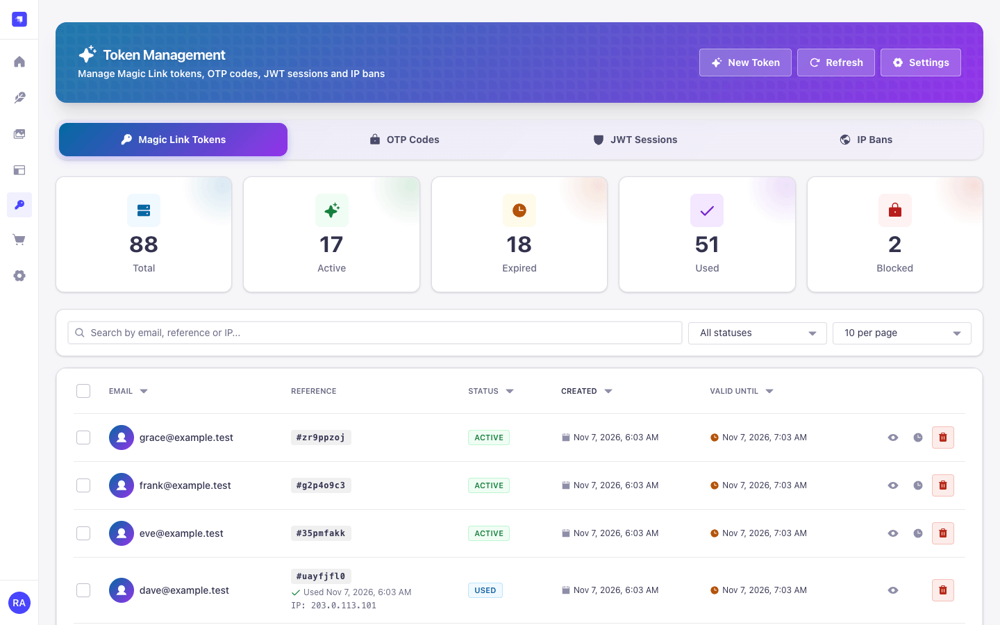
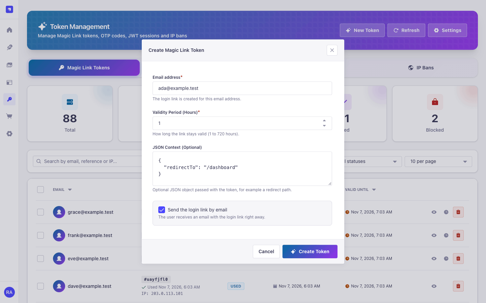
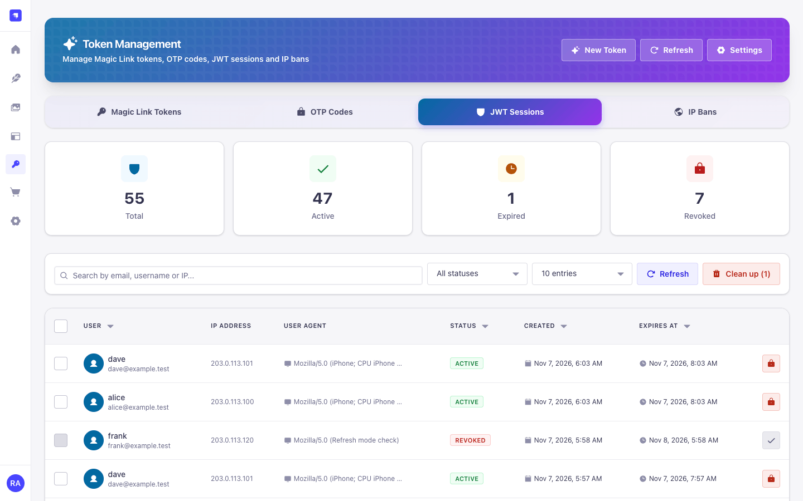
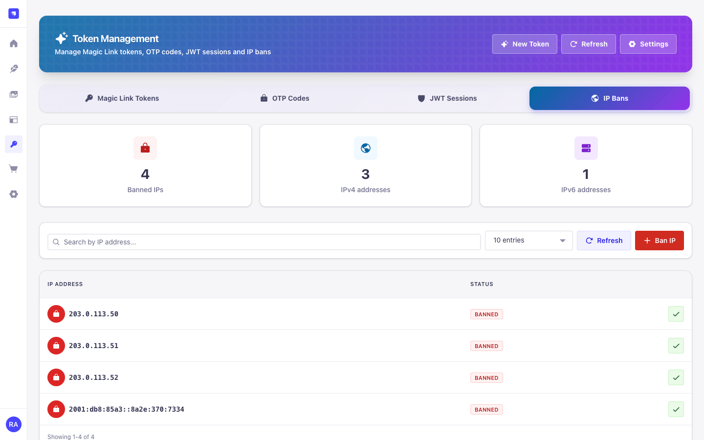
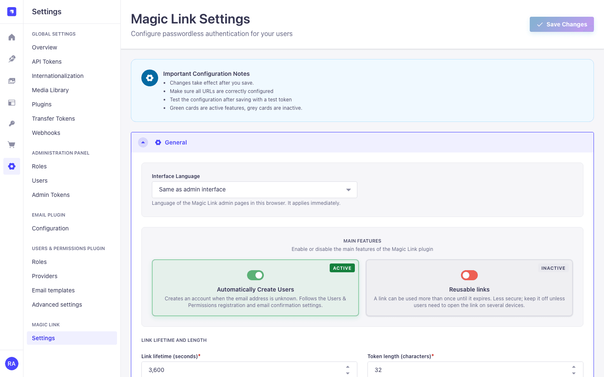
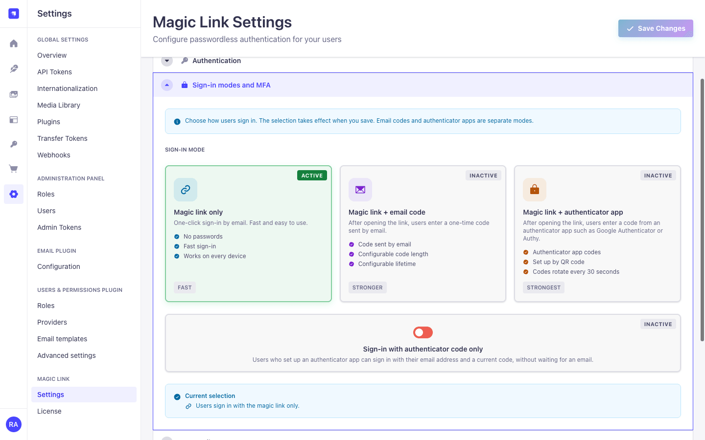
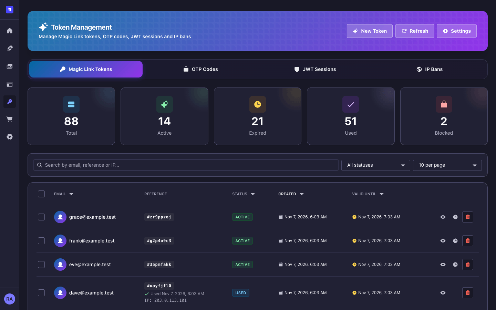
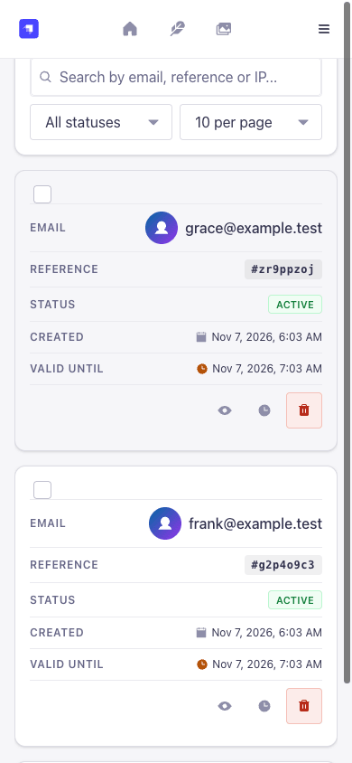
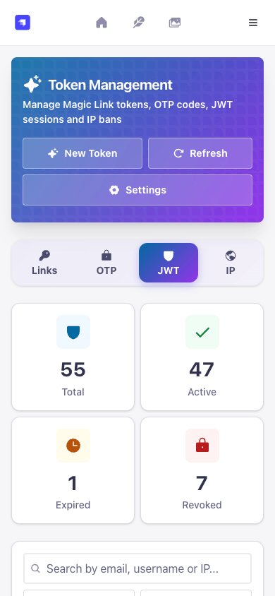

<p align="center">
  
</p>

# Magic Link for Strapi 5

Passwordless login for Strapi 5. Your users type their e-mail address, click the link in their inbox and get a normal Users & Permissions session, the same kind `/api/auth/local` creates. When a link is not enough, add a second factor: an e-mailed one-time code (OTP) or an authenticator app (TOTP) with backup codes.

[](https://www.npmjs.com/package/strapi-plugin-magic-link-v5)
[](https://www.npmjs.com/package/strapi-plugin-magic-link-v5)
[](LICENSE)
[](#compatibility)
[](#compatibility)

**Live docs:** [schero94.github.io/strapi-plugin-magic-link-v5](https://schero94.github.io/strapi-plugin-magic-link-v5/) · [npm](https://www.npmjs.com/package/strapi-plugin-magic-link-v5) · [Changelog](CHANGELOG.md) · [Issues](https://github.com/Schero94/strapi-plugin-magic-link-v5/issues)



Free and open source (MIT). Every feature is available to every installation, and the plugin sends no telemetry and never phones home.

## In one minute

```bash
npm install strapi-plugin-magic-link-v5
echo "MAGIC_LINK_ENCRYPTION_KEY=$(node -e "console.log(require('crypto').randomBytes(32).toString('hex'))")" >> .env
echo "MAGIC_LINK_OTP_PEPPER=$(node -e "console.log(require('crypto').randomBytes(32).toString('hex'))")" >> .env
npm run build && npm run develop
```

With a Strapi e-mail provider configured, ask for a link:

```bash
curl -X POST http://localhost:1337/api/magic-link/send-link \
  -H 'Content-Type: application/json' -d '{"email":"ada@example.com"}'
```

Your landing page then posts the `loginToken` from the link to `POST /api/magic-link/login` and gets `{ jwt, user }` back. The [quick start](#quick-start-5-minutes) walks through each step, including the e-mail provider and the frontend URL.

## Contents

- [What you get](#what-you-get)
- [Screenshots](#screenshots)
- [Compatibility](#compatibility)
- [Quick start (5 minutes)](#quick-start-5-minutes)
- [Frontend integration](#frontend-integration)
- [Second factors: e-mail OTP, TOTP and backup codes](#second-factors-e-mail-otp-totp-and-backup-codes)
- [Refresh mode (users-permissions sessions)](#refresh-mode-users-permissions-sessions)
- [Public API](#public-api)
- [Errors](#errors)
- [Admin API](#admin-api)
- [Permissions](#permissions)
- [Configuration reference](#configuration-reference)
- [E-mail templates](#e-mail-templates)
- [Delivery status](#delivery-status)
- [Security model](#security-model)
- [Privacy and outbound connections](#privacy-and-outbound-connections)
- [Performance](#performance)
- [Running behind a proxy or in a cluster](#running-behind-a-proxy-or-in-a-cluster)
- [Running several instances (Railway replicas, pm2 cluster)](#running-several-instances-railway-replicas-pm2-cluster)
- [Migrating from strapi-plugin-passwordless](#migrating-from-strapi-plugin-passwordless)
- [FAQ](#faq)
- [Troubleshooting](#troubleshooting)
- [Upgrading from 6.x to 7.0.0](#upgrading-from-6x-to-700)
- [Upgrading from 5.x to 6.0.0](#upgrading-from-5x-to-600)
- [Languages, license and support](#languages-license-and-support)

## What you get

- **Magic links by e-mail.** One API call sends the link. Your landing page exchanges it for a JWT.
- **Optional second factors.**
  - E-mail OTP after the link click.
  - Authenticator apps (TOTP) as optional or required MFA: enrolment during sign-in, self-service for logged-in users, and one-time backup codes.
  - TOTP-only login without an e-mail round trip.
- **Built for production.**
  - Links are stored hashed, expire, and a single-use link is consumed atomically.
  - Rate limits per IP and per address, IP bans, and an always-on limit for code checks.
  - A JWT session list with revocation, also for users-permissions refresh sessions.
- **Works with your stack.** Users & Permissions (legacy JWTs and refresh-token sessions), the Strapi e-mail plugin, Magic Mail, Email Designer 5, and a `strapi-plugin-passwordless` compatibility mode.
- **Admin panel.**
  - Pages for tokens, OTP codes, JWT sessions, IP bans and settings.
  - Light and dark mode, translated into English, German, French, Spanish and Portuguese.
  - Fine-grained admin permissions, enforced on the server.

Magic Link is **e-mail only**. WhatsApp and SMS delivery were removed in 6.0.0.

## Screenshots

All screenshots use synthetic data (`example.test` addresses and documentation IP ranges).

| Tokens                                                                                                                                    | Create a token                                                                                                                       |
| ----------------------------------------------------------------------------------------------------------------------------------------- | ------------------------------------------------------------------------------------------------------------------------------------ |
|  |  |

| JWT sessions                                                                                                                                       | IP bans                                                                                                                                 |
| -------------------------------------------------------------------------------------------------------------------------------------------------- | --------------------------------------------------------------------------------------------------------------------------------------- |
|  |  |

| Settings: general                                                                                                                  | Settings: sign-in modes and MFA                                                                                                      |
| ---------------------------------------------------------------------------------------------------------------------------------- | ------------------------------------------------------------------------------------------------------------------------------------ |
|  |  |

| Dark mode                                                                                                                     |
| ----------------------------------------------------------------------------------------------------------------------------- |
|  |

On phones the tables turn into cards:

| Tokens on a phone                                                                                                                              | JWT sessions on a phone                                                                                                                                |
| ---------------------------------------------------------------------------------------------------------------------------------------------- | ------------------------------------------------------------------------------------------------------------------------------------------------------ |
|  |  |

## Compatibility

| Magic Link | Strapi                                    | Node.js  | Notes                                                                 |
| ---------- | ----------------------------------------- | -------- | --------------------------------------------------------------------- |
| 7.x        | 5.24.0 or newer (acceptance host: 5.61.0) | 22 to 26 | No registration key, no outbound calls of its own                     |
| 6.x        | 5.24.0 or newer                           | 22 to 26 | Security release; see [Upgrading from 5.x](#upgrading-from-5x-to-600) |
| 5.x        | 5.0.0 or newer                            | 18 to 22 | Releases come from `main` only; upgrade to 7.x                        |

What the host needs:

| Component           | Version                                                                                  |
| ------------------- | ---------------------------------------------------------------------------------------- |
| Strapi              | 5.24.0 or newer. Refresh mode with the httpOnly cookie needs 5.33.3+.                    |
| Node.js             | 22 to 26 (the range Strapi 5.61 supports)                                                |
| Users & Permissions | Installed (default in Strapi 5)                                                          |
| E-mail              | A configured Strapi e-mail provider, or Magic Mail                                       |
| Environment         | `MAGIC_LINK_ENCRYPTION_KEY` and `MAGIC_LINK_OTP_PEPPER`, 32+ characters each (see below) |
| Database            | SQLite, PostgreSQL or MySQL/MariaDB, as supported by Strapi                              |

The admin panel uses the Design System, icons and `react-intl` that every Strapi 5 admin already ships. They are optional peer dependencies, so npm, yarn and pnpm install the plugin into a fresh Strapi 5 project without peer warnings.

## Quick start (5 minutes)

### 1. Install

```bash
npm install strapi-plugin-magic-link-v5
```

### 2. Set the two required secrets

The plugin refuses to start without them, also in development:

```bash
# .env, generate each value with:
# node -e "console.log(require('crypto').randomBytes(32).toString('hex'))"
MAGIC_LINK_ENCRYPTION_KEY=<64 hex characters>
MAGIC_LINK_OTP_PEPPER=<64 hex characters>
```

For a throwaway local setup you can set `MAGIC_LINK_ALLOW_DEV_SECRETS=true` instead. It is ignored when `NODE_ENV=production`.

### 3. Configure e-mail

Any Strapi e-mail provider works. Example with Nodemailer in `config/plugins.js`:

```js
module.exports = ({ env }) => ({
  email: {
    config: {
      provider: 'nodemailer',
      providerOptions: {
        host: env('SMTP_HOST'),
        port: env.int('SMTP_PORT', 587),
        auth: { user: env('SMTP_USERNAME'), pass: env('SMTP_PASSWORD') },
      },
      settings: {
        defaultFrom: 'login@example.com',
        defaultReplyTo: 'support@example.com',
      },
    },
  },
});
```

### 4. Build, start and point links at your frontend

```bash
npm run build && npm run develop
```

In the admin panel, open **Settings > Magic Link > Settings > General**:

- **Frontend base URL**: `https://app.example.com`
- **Frontend login path**: `/auth/magic-link`

Links now look like `https://app.example.com/auth/magic-link?loginToken=...`. URLs must use `https`; `http` is accepted only for `localhost`.

### 5. Send your first link

```bash
curl -X POST http://localhost:1337/api/magic-link/send-link \
  -H 'Content-Type: application/json' \
  -d '{"email":"ada@example.com"}'
```

```json
{ "email": "ada@example.com", "username": null, "sent": true, "delivery": "email" }
```

The answer is the same whether or not the account exists, so nobody can use it to find out who has an account. By default only existing users get a link; see [auto-registration](#auto-registration) to create accounts on first login.

The public routes need no role configuration. They are open by design (`auth: false`) and protected by rate limits and IP bans.

## Frontend integration

A complete login has three parts: a form that requests the link, a landing page that exchanges the token, and a place to keep the JWT.

### 1. Request the link

```js
// Login form, framework-agnostic
const API = 'https://api.example.com/api/magic-link';

export async function requestMagicLink(email) {
  const response = await fetch(`${API}/send-link`, {
    method: 'POST',
    headers: { 'Content-Type': 'application/json' },
    // Optional context comes back in the login response (see below).
    body: JSON.stringify({ email, context: { redirectTo: '/dashboard' } }),
  });
  if (response.status === 429) {
    throw new Error('Too many requests. Please wait a moment and try again.');
  }
  if (!response.ok) {
    const { error } = await response.json();
    throw new Error(error?.message || 'The link could not be requested.');
  }
  // Always "sent": tell the user to check their inbox.
}
```

### 2. Exchange the token on the landing page

The landing page receives `?loginToken=...`. Send the token to Strapi with **POST**, so it never shows up in access logs, caches or `Referer` headers, then react to the answer.

```js
// /auth/magic-link page
async function post(path, body) {
  const response = await fetch(`${API}${path}`, {
    method: 'POST',
    headers: { 'Content-Type': 'application/json' },
    credentials: 'include', // only needed for the httpOnly refresh cookie
    body: JSON.stringify(body),
  });
  const data = await response.json();
  if (!response.ok) throw Object.assign(new Error(data.error?.message), { data });
  return data;
}

export async function completeMagicLink() {
  const loginToken = new URLSearchParams(location.search).get('loginToken');
  history.replaceState(null, '', location.pathname); // drop the token from the address bar

  const result = await post('/login', { loginToken });

  if (result.requiresOTP) {
    // An e-mailed code is required. Ask the user for it, then:
    const code = await askUser('Enter the code from your e-mail');
    return post('/otp/verify', { email: result.email, code, magicLinkToken: result.loginToken });
  }

  if (result.requiresTOTP) {
    // The user has an authenticator. A backup code works too: { loginToken, backupCode }
    const totpCode = await askUser('Enter the code from your authenticator app');
    return post('/verify-mfa-totp', { loginToken: result.loginToken, totpCode });
  }

  if (result.requiresTOTPSetup) {
    // MFA is required and the user has no authenticator yet: enrol now.
    const { data } = await post('/totp/enroll', { loginToken: result.loginToken });
    showQrCode(data.qrCode); // data URL; data.secret for manual entry
    const totpCode = await askUser('Scan the QR code and enter the code');
    const session = await post('/totp/enroll/confirm', { loginToken: result.loginToken, totpCode });
    showBackupCodesOnce(session.backupCodes);
    return session;
  }

  return result; // { jwt, user, context, expires_at, refreshToken? }
}
```

`askUser`, `showQrCode` and `showBackupCodesOnce` stand for your own UI.

### 3. Store the JWT and call your API

The `jwt` is a normal users-permissions JWT. Send it as `Authorization: Bearer <jwt>`.

```js
const session = await completeMagicLink();
sessionStorage.setItem('jwt', session.jwt); // or keep it in memory
location.assign(session.context?.redirectTo || '/');

// Later
const me = await fetch('https://api.example.com/api/users/me', {
  headers: { Authorization: `Bearer ${sessionStorage.getItem('jwt')}` },
}).then((r) => r.json());
```

Anything in web storage can be read by a script injected into your page. If that matters for you, keep the JWT in memory and use [refresh mode](#refresh-mode-users-permissions-sessions) with the refresh token in an httpOnly cookie.

`GET /api/magic-link/login?loginToken=...` still works. You can point `confirmationUrl` straight at it, but the token then ends up in server logs, so prefer the POST exchange.

### Where the link points

The link builder uses the first match:

1. `frontend_url` + `frontend_login_path` (recommended)
2. `confirmationUrl`
3. `<server.url><api prefix>/magic-link/login` (the API route itself)

Existing query strings are kept and `loginToken` is appended.

### Passing context through the link

`send-link` accepts a small `context` object, for example `{ "redirectTo": "/billing" }`. It comes back in the login response. Rules:

- at most 20 keys;
- the `context_whitelist` / `context_blacklist` settings apply;
- reserved keys that carry authentication state (`otpVerified`, `mfaVerified`, `userId`, `exp`, ...) are rejected with 400.

## Second factors: e-mail OTP, TOTP and backup codes

Choose the mode in **Settings > Magic Link > Settings > Sign-in modes and MFA**.

| Mode                  | Setting                | What the user does after clicking the link                  |
| --------------------- | ---------------------- | ----------------------------------------------------------- |
| Link only             | defaults               | Nothing, the link logs them in                              |
| Link + e-mail OTP     | `otp_enabled: true`    | Enters a 6-digit code sent in a second e-mail               |
| Link + TOTP, optional | `mfa_mode: "optional"` | Users with an authenticator enter a code; others log in     |
| Link + TOTP, required | `mfa_mode: "required"` | Everyone enters a code; users without one enrol on the spot |

| TOTP only | `totp_as_primary_auth: true` | Calls `POST /login-totp { email, totpCode }`, no e-mail |

A user with an active authenticator always gets the TOTP step, even when e-mail OTP is also enabled.

**Switching to `required` while nobody is enrolled.** The settings API refuses `mfa_mode: "required"` (or the legacy `mfa_require_totp: true`) with `400` and `error.details.key: 'settings.mfa.noEnrolledUsers'` while no end user has an active authenticator, because a frontend without the enrolment step would lock everyone out. Start with `optional` so users can enrol, or, if your landing page handles `requiresTOTPSetup`, send `acknowledgeNoEnrolledUsers: true` with the update (`{ "settings": { "mfa_mode": "required" }, "acknowledgeNoEnrolledUsers": true }`). The flag is never stored. The admin panel blocks the option in the same situation.

### End-user TOTP enrolment

There are two ways for a user to add an authenticator.

**During sign-in (required MFA).** When `mfa_mode` is `required` and the user has no authenticator, `/login` answers `requiresTOTPSetup`. The landing page calls `POST /totp/enroll { loginToken }`, shows the QR code, and finishes with `POST /totp/enroll/confirm { loginToken, totpCode }`. That response is the session plus ten backup codes (see the [frontend example](#2-exchange-the-token-on-the-landing-page)). The pending setup is valid for 15 minutes. The link click already proved the mailbox, so no extra e-mail code is needed.

**From the account (self-service).** These routes use the users-permissions JWT. Grant the **Magic-link > totp** actions (`status`, `setup`, `confirm`, `disable`, `backupCodes`) to the **Authenticated** role in _Settings > Users & Permissions > Roles_.

```js
const auth = { Authorization: `Bearer ${jwt}`, 'Content-Type': 'application/json' };

// 1. Start: returns the QR code and e-mails a confirmation code.
//    With an active authenticator, also send { totpCode } from the current app.
const { data } = await fetch(`${API}/totp/setup`, {
  method: 'POST',
  headers: auth,
  body: '{}',
}).then((r) => r.json());
// data: { secret, qrCode, otpauthUrl, algorithm, digits, period, expiresAt, emailCodeSent: true }

// 2. Confirm with a code from the app AND the e-mailed code.
await fetch(`${API}/totp/confirm`, {
  method: 'POST',
  headers: auth,
  body: JSON.stringify({ totpCode, emailCode }),
});
// { data: { enabled: true, backupCodes: [10 codes, shown once] } }

// Status, new backup codes (needs a current code), remove (TOTP or backup code)
await fetch(`${API}/totp/status`, { headers: auth });
// { data: { configured, enabled, pendingSetup, lastUsed, backupCodesRemaining,
//           algorithm, digits, period, mfaMode } }
await fetch(`${API}/totp/backup-codes`, {
  method: 'POST',
  headers: auth,
  body: JSON.stringify({ totpCode }),
});
await fetch(`${API}/totp/disable`, {
  method: 'POST',
  headers: auth,
  body: JSON.stringify({ totpCode }),
});
```

A stolen JWT alone cannot add, replace or remove an authenticator:

- Setup needs the e-mailed code.
- Re-setup and new backup codes need a current TOTP code.
- Removal needs a TOTP code or a backup code.

### Backup codes

- Ten 16-character codes (`XXXX-XXXX-XXXX-XXXX`), shown once.
- Stored as keyed hashes bound to their owner.
- Each code works once wherever a TOTP code is accepted after a magic link (`backupCode` instead of `totpCode`).
- The response reports `backupCodesRemaining`.

Algorithm, digits and period are stored with each enrolment, so changing the TOTP settings only affects new enrolments. Each accepted time step is recorded, so a code cannot be replayed.

## Refresh mode (users-permissions sessions)

With `jwtManagement: 'refresh'` in the users-permissions config, Magic Link logins behave like `/api/auth/local`: the plugin creates the session through the users-permissions session manager.

**Versions.** The users-permissions session manager and `jwtManagement` exist since Strapi 5.24.0. Strapi's own `POST /api/auth/refresh` reads the refresh token from the httpOnly cookie only from 5.33.3 on (checked in the `@strapi/plugin-users-permissions` 5.33.2 and 5.33.3 sources); on 5.24 to 5.33.2 send the refresh token in the request body instead of using the cookie.

```js
// config/plugins.js
module.exports = {
  'users-permissions': {
    config: {
      jwtManagement: 'refresh',
      sessions: { accessTokenLifespan: 600, maxRefreshTokenLifespan: 1209600, httpOnly: false },
    },
  },
};
```

- The response contains a short-lived `jwt` and a `refreshToken`. With `sessions.httpOnly: true`, or the request header `x-strapi-refresh-cookie: httpOnly`, the refresh token is set as an httpOnly cookie (default name `strapi_up_refresh`) instead and left out of the body.
- Renew with the native `POST /api/auth/refresh`, sending `{ refreshToken }` or the cookie. Log out with `POST /api/auth/logout`.
- You may send `deviceId` with `/login`, `/verify-mfa-totp`, `/login-totp` or `/totp/enroll/confirm`, as with `/api/auth/local`. Without it, every Magic Link login gets its own device id.
- Revoking a session in **Magic Link > JWT Sessions** ends the whole users-permissions refresh family: the first refresh token and every token rotated from it. (`POST /api/auth/refresh` creates a new session id with the same device id; the plugin revokes by user and device id.) A client that reuses one `deviceId` for several logins gets all of them ended, like the users-permissions device logout.
- Access tokens minted from a revoked family are rejected as well. users-permissions itself accepts an access token until it expires. While a user has a revoked family (until the family's maximum lifetime plus one access-token lifespan), the plugin checks the users-permissions session of each of that user's access tokens (`isSessionActive`, one database lookup per request for that user only). It answers `401` when the session is gone and `503` when the state cannot be read.
- Session records written before the device id was stored can only revoke the first refresh token.

In the default `legacy-support` mode the JWT lifetime comes from the plugin setting `jwt_token_expires_in` (for example `15m`, `12h`, `30d`).

## Public API

All routes are under `/api/magic-link` (or your `api.rest.prefix`). Every answer from these route handlers sends `Cache-Control: no-store` and `Referrer-Policy: no-referrer` (a request refused by the IP-ban check is answered before the handler runs). Unknown body fields are rejected with 400.

| Method | Path                   | Auth              | Body                                                       | Success response                                                                 |
| ------ | ---------------------- | ----------------- | ---------------------------------------------------------- | -------------------------------------------------------------------------------- |
| `POST` | `/send-link`           | none              | `{ email, username?, context?, delivery? }`                | `{ email, username, sent: true, delivery: "email" }`                             |
| `POST` | `/login`               | none              | `{ loginToken, deviceId? }`                                | session, or a challenge (`requiresOTP`, `requiresTOTP`, `requiresTOTPSetup`)     |
| `GET`  | `/login?loginToken=`   | none              | (query)                                                    | same as `POST /login`                                                            |
| `POST` | `/otp/send`            | none              | `{ email, magicLinkToken }`                                | `{ success, message, expiresIn, type: "email" }`                                 |
| `POST` | `/otp/resend`          | none              | `{ email, magicLinkToken }`                                | `{ success, message, expiresIn }`, after `otp_resend_cooldown`                   |
| `POST` | `/otp/verify`          | none              | `{ email, code, magicLinkToken }`                          | session with `otpVerified: true`                                                 |
| `POST` | `/verify-mfa-totp`     | none              | `{ loginToken, totpCode }` or `{ loginToken, backupCode }` | session with `mfaVerified: true`                                                 |
| `POST` | `/login-totp`          | none              | `{ email, totpCode }`                                      | session with `loginMethod: "totp"` (TOTP-only mode)                              |
| `POST` | `/totp/enroll`         | none (loginToken) | `{ loginToken }`                                           | `{ data: { secret, qrCode, otpauthUrl, algorithm, digits, period, expiresAt } }` |
| `POST` | `/totp/enroll/confirm` | none (loginToken) | `{ loginToken, totpCode }`                                 | session plus `backupCodes`                                                       |
| `GET`  | `/totp/status`         | users-permissions |                                                            | `{ data: { configured, enabled, ..., mfaMode } }`                                |
| `POST` | `/totp/setup`          | users-permissions | `{}` or `{ totpCode }` when already enrolled               | `{ data: { secret, qrCode, ..., emailCodeSent: true } }`                         |
| `POST` | `/totp/confirm`        | users-permissions | `{ totpCode, emailCode }`                                  | `{ data: { enabled: true, backupCodes } }`                                       |
| `POST` | `/totp/disable`        | users-permissions | `{ totpCode }` or `{ backupCode }`                         | `{ data: { enabled: false } }`                                                   |
| `POST` | `/totp/backup-codes`   | users-permissions | `{ totpCode }`                                             | `{ data: { backupCodes } }`                                                      |

`magicLinkToken` is the `loginToken` from the `/login` challenge. It is required while `otp_strict_binding` is on (the default).

### Session response

Every successful login answers like this:

```json
{
  "jwt": "eyJhbGciOi...",
  "user": {
    "id": 7,
    "documentId": "abc123",
    "username": "ada",
    "email": "ada@example.com",
    "confirmed": true,
    "blocked": false
  },
  "context": { "redirectTo": "/billing" },
  "expires_at": "2026-12-07T10:00:00.000Z",
  "refreshToken": "only in refresh mode, unless the cookie is used"
}
```

- The user object passes Strapi's content-API sanitizer, so private fields are never returned.
- Second-factor logins add `otpVerified: true`, `mfaVerified: true` (plus `backupCodesRemaining` after a backup code) or `loginMethod: "totp"`.
- With `use_jwt_token: false` no token is minted: the body has `user`, `context` and `jwtIssued: false`.

### Challenge responses from `/login`

```json
{ "requiresOTP": true, "message": "OTP verification required", "email": "ada@example.com", "loginToken": "...", "expiresIn": 300 }
{ "requiresTOTP": true, "message": "TOTP verification required for MFA", "email": "ada@example.com", "loginToken": "..." }
{ "requiresTOTPSetup": true, "message": "Set up an authenticator app to continue", "email": "ada@example.com", "loginToken": "...", "enrollEndpoint": "/api/magic-link/totp/enroll" }
```

Opening the same link again while a challenge is pending returns the same challenge. It does not send a new e-mail while the code is still valid.

## Errors

Most errors use the Strapi error envelope with a stable `key`:

```json
{
  "data": null,
  "error": {
    "status": 400,
    "name": "ValidationError",
    "message": "Invalid or expired token",
    "key": "token.invalid",
    "details": { "key": "token.invalid" }
  }
}
```

`message` is translated (`en`, `de`, `fr`, `es`, `pt`) from `?locale=` or `Accept-Language`. Build your UI on `key`, not on the text.

| Status | `key`                      | When                                                                             |
| ------ | -------------------------- | -------------------------------------------------------------------------------- |
| 400    | `token.invalid`            | The link is missing, expired, used, blocked, or its account no longer exists     |
| 400    | `challenge.invalid`        | The `loginToken` has no matching pending TOTP or enrolment step                  |
| 400    | `mfa.invalidCode`          | Wrong TOTP or backup code                                                        |
| 400    | `credentials.invalid`      | `/login-totp`: unknown account, no authenticator or wrong code (one answer)      |
| 400    | `totp.noPendingSetup`      | Confirm without a started setup, or the setup expired                            |
| 400    | `totp.invalidEmailCode`    | `/totp/confirm`: the e-mailed code is wrong or expired                           |
| 400    | `totp.notEnrolled`         | `/totp/disable` or `/totp/backup-codes` without an authenticator                 |
| 401    | `auth.required`            | Self-service routes without a users-permissions JWT                              |
| 403    | `blocked.user`             | The account is blocked                                                           |
| 403    | `totp.currentCodeRequired` | `/totp/setup` while an authenticator is active, without a current `totpCode`     |
| 403    | `totp.loginDisabled`       | `/login-totp` while `totp_as_primary_auth` is off                                |
| 409    | `totp.alreadyEnrolled`     | `/totp/enroll` for a user who already has an authenticator                       |
| 429    | `rate.limit.exceeded`      | Rate limit hit; `details.retryAfter` and the `Retry-After` header give seconds   |
| 503    | `otp.deliveryFailed`       | The OTP e-mail could not be sent (`details.resendEndpoint` points at the resend) |

Some answers do not carry a `key`. Handle them by status:

- **Body validation** (unknown field, bad e-mail, removed `phoneNumber`/`phone`/`via`/non-e-mail `delivery`): `400 ValidationError` with a message such as `Invalid request body at 'email': ...`.
- **IP bans**: `403 PolicyError` with `details.code: "IP_ADDRESS_BLOCKED"`, or `details.code: "IP_BAN_CHECK_UNAVAILABLE"` when the ban list cannot be read.
- **`/otp/send`, `/otp/resend`, `/otp/verify`**: plain Strapi errors.
  - A wrong or expired code answers `400` "Invalid or expired verification code".
  - Limits answer `429` with a "try again in N seconds" message and a `Retry-After` header.
  - A failed OTP e-mail answers `503 { "success": false, "error": { "code": "OTP_EMAIL_FAILED", ... } }`.
  - A `magicLinkToken` that does not match gets the same answer as a valid one (`{ "success": true, "message": "If the request is valid, a verification code will be sent." }`), so the route cannot be used to test tokens.
- **Revoked JWTs** on any Content API route: `401 UnauthorizedError` "This token has been revoked"; `503` when the revocation state cannot be read.

## Admin API

Admin routes live under `/magic-link` on the Strapi server (not under `/api`). They need an admin JWT (`Authorization: Bearer <admin token>`) and the listed permission. The admin pages use them; you rarely need them directly.

| Method   | Path                                  | Permission        | Purpose                                                                                                    |
| -------- | ------------------------------------- | ----------------- | ---------------------------------------------------------------------------------------------------------- |
| `GET`    | `/magic-link/tokens`                  | `read`            | Newest 1000 tokens, or `?page=&pageSize=` (max 1000)                                                       |
| `POST`   | `/magic-link/tokens`                  | `manage`          | Create a link: `{ email, ttl?, send_email?, context? }` (ttl in hours, 1-720)                              |
| `POST`   | `/magic-link/tokens/:id/block`        | `manage`          | Deactivate a link                                                                                          |
| `POST`   | `/magic-link/tokens/:id/activate`     | `manage`          | Re-activate (refused for used single-use or expired links)                                                 |
| `POST`   | `/magic-link/tokens/:id/extend`       | `manage`          | `{ days }`, 1-365 (default 7)                                                                              |
| `DELETE` | `/magic-link/tokens/:id`              | `manage`          | Delete a link                                                                                              |
| `GET`    | `/magic-link/jwt-sessions`            | `read`            | Newest 1000 sessions issued by Magic Link, or `?page=&pageSize=&status=&userId=`; total in `X-Total-Count` |
| `POST`   | `/magic-link/revoke-jwt`              | `manage`          | `{ sessionId }` or `{ token }`                                                                             |
| `POST`   | `/magic-link/unrevoke-jwt`            | `manage`          | `{ sessionId }` (not for refresh-mode sessions)                                                            |
| `POST`   | `/magic-link/cleanup-sessions`        | `manage`          | Remove expired session records                                                                             |
| `GET`    | `/magic-link/banned-ips`              | `read`            | `{ ips: [...] }`                                                                                           |
| `POST`   | `/magic-link/ban-ip`                  | `manage`          | `{ data: { ip } }`                                                                                         |
| `POST`   | `/magic-link/unban-ip`                | `manage`          | `{ data: { ip } }`                                                                                         |
| `GET`    | `/magic-link/otp/codes`               | `read`            | `?page=&pageSize=&email=&type=&status=`; codes, stats and pagination (no code hashes)                      |
| `DELETE` | `/magic-link/otp/codes/:id`           | `manage`          | Delete one code                                                                                            |
| `POST`   | `/magic-link/otp/cleanup`             | `manage`          | Remove expired codes                                                                                       |
| `GET`    | `/magic-link/settings`                | `settings.read`   | Read settings                                                                                              |
| `PUT`    | `/magic-link/settings`                | `settings.update` | Save settings (only known keys, validated); security settings also need `settings.security`                |
| `POST`   | `/magic-link/reset-data`              | `settings.update` | Restore defaults: `{ confirm: 'RESET', resetSecurity? }`; also needs `settings.security`                   |
| `GET`    | `/magic-link/rate-limit/stats`        | `settings.read`   | Limiter statistics                                                                                         |
| `POST`   | `/magic-link/rate-limit/cleanup`      | `settings.update` | Drop expired limiter entries                                                                               |
| `POST`   | `/magic-link/rate-limit/reset`        | `settings.update` | Reset all limits                                                                                           |
| `GET`    | `/magic-link/totp/enrollment-summary` | `settings.read`   | `{ data: { enrolled, enrollmentDuringLogin } }`                                                            |
| `GET`    | `/magic-link/otp/totp/status`         | `read`            | The calling admin's own authenticator                                                                      |
| `POST`   | `/magic-link/otp/totp/setup`          | `read`            | Start setup (`{ token }` when one is active)                                                               |
| `POST`   | `/magic-link/otp/totp/verify`         | `read`            | Confirm setup, returns backup codes                                                                        |
| `POST`   | `/magic-link/otp/totp/disable`        | `read`            | `{ token }`                                                                                                |
| `POST`   | `/magic-link/otp/totp/backup-codes`   | `read`            | `{ token }`                                                                                                |

A missing permission answers `403`; a missing or expired admin token answers `401`.

`reset-data` needs `settings.security` as well as `settings.update`, because it also deletes every login token, the JWT session list and all IP bans and resets link targets, templates, sender and code rules. The MFA settings are kept unless `resetSecurity: true` is sent. Active JWT revocations are kept. Without the session list, refresh-mode sessions can no longer be revoked from the admin panel.

#### Example: create and e-mail a link

```bash
curl -X POST http://localhost:1337/magic-link/tokens \
  -H "Authorization: Bearer $ADMIN_JWT" -H 'Content-Type: application/json' \
  -d '{"email":"ada@example.com","ttl":24,"context":{"redirectTo":"/onboarding"}}'
```

```json
{
  "id": 42,
  "documentId": "k2m9x0...",
  "email": "ada@example.com",
  "expires_at": "2026-11-08T10:00:00.000Z",
  "is_active": true,
  "is_used": false,
  "context": { "redirectTo": "/onboarding" },
  "sent": true
}
```

- With `send_email: false` the link is not mailed. The response then also carries `token` and `loginUrl`, once, which lets the admin log in as that user. That needs the separate `tokens.issue` permission (otherwise `403 PolicyError` with `details.key: "tokens.issue.forbidden"`).
- An unknown address gets an account only when `createUserIfNotExists` is on; otherwise `400`. A blocked user answers `400`.
- Creation is limited to 60 per admin per 15 minutes (`429` with `details.retryAfter`).
- If the e-mail cannot be sent, the token is deactivated and the answer is `503`.

#### Example: revoke a session and ban an address

```bash
curl -X POST http://localhost:1337/magic-link/revoke-jwt \
  -H "Authorization: Bearer $ADMIN_JWT" -H 'Content-Type: application/json' \
  -d '{"sessionId":"session_1762500000000_a1b2c3d4e5f6"}'
# { "success": true, "message": "JWT session revoked successfully" }   (404 when the id is unknown)

curl -X POST http://localhost:1337/magic-link/ban-ip \
  -H "Authorization: Bearer $ADMIN_JWT" -H 'Content-Type: application/json' \
  -d '{"data":{"ip":"203.0.113.50"}}'
# { "success": true, "message": "IP 203.0.113.50 has been banned" }   (400 for an invalid address)
```

## Permissions

### Admin roles (Settings > Administration Panel > Roles > Plugins > Magic Link)

| Action                                 | Grants                                                                   |
| -------------------------------------- | ------------------------------------------------------------------------ |
| `plugin::magic-link.read`              | Menu entry and Tokens page: tokens, OTP codes, JWT sessions, IP bans     |
| `plugin::magic-link.manage`            | Create, block, extend, delete tokens; revoke sessions; ban IPs; cleanups |
| `plugin::magic-link.tokens.issue`      | Create links without e-mail (impersonation). Grant sparingly.            |
| `plugin::magic-link.settings.read`     | Settings page                                                            |
| `plugin::magic-link.settings.update`   | Save settings, rate-limit actions                                        |
| `plugin::magic-link.settings.security` | Change security settings (see below), reset MFA settings                 |

The server enforces these on every route; the admin pages hide what a role cannot do. Super Admin has all of them.

**Role migration from 5.x.** 5.x had a single `plugin::magic-link.access` action. On the first start of 6.0.0, every admin role (and admin API token) that still holds it gets **Read** and **Manage**, and the old permission is removed. `tokens.issue`, `settings.read`, `settings.update` and `settings.security` are never granted automatically. After the upgrade, open each role and grant **Settings > Read** to roles that need the Settings page. If Strapi already dropped the unknown `access` action before the migration ran, there is nothing to migrate: grant the new actions by hand.

**Security settings** need `settings.security` in addition to `settings.update`. They can redirect login links (and the login token in them) to another site, put the raw token into a template, or change who may log in and with which factors: `confirmationUrl`, `callback_url`, `frontend_url`, `frontend_login_path`, `login_path`, `passwordlessCompatibility`, `message_html`, `message_text`, the Email Designer and Magic Mail template fields, `enabled`, `createUserIfNotExists`, `user_creation_strategy`, `allow_magic_links_on_public_registration`, `verify_email`, `stays_valid`, `expire_period`, `token_length`, `use_jwt_token`, `jwt_token_expires_in`, `context_whitelist`, `context_blacklist`, `mfa_mode`, `mfa_require_totp`, `totp_as_primary_auth`, `otp_enabled`, `otp_strict_binding`, and the code and brute-force rules `otp_length`, `otp_expiry`, `otp_max_attempts`, `otp_resend_cooldown`, `totp_algorithm`, `totp_digits`, `totp_period`, `rate_limit_enabled`, `rate_limit_max_attempts`, `rate_limit_window_minutes`, `rate_limit_login_*`, and the sender identity `from_name`, `from_email` and `response_email`.

- Sending them unchanged is allowed, so a role with `settings.update` only can still save the subject, welcome mail, login-info and TOTP issuer.
- `reset-data` needs `settings.security`.
- A refused change answers `403` with `error.details.key: 'settings.security.forbidden'` and the field names; nothing is written.
- `settings.security` is never granted automatically. Grant it only to roles that may decide where login links point (Super Admin has it).

For a hard limit that no admin can change, list the allowed link origins in the server config (`allowedLinkOrigins`, see [Plugin config](#plugin-config-configpluginsjs)).

### Users & Permissions roles

- **Public:** nothing to grant. The login routes are public (`auth: false`) and protected by rate limits and IP bans.
- **Authenticated:** grant the **Magic-link > totp** actions if users should manage their authenticator themselves.

## Configuration reference

### Settings (admin panel)

Stored in the plugin store and edited in **Settings > Magic Link > Settings**. Unknown keys are ignored.

| Key                                                                                                  | Default                         | Meaning                                                               |
| ---------------------------------------------------------------------------------------------------- | ------------------------------- | --------------------------------------------------------------------- |
| `enabled`                                                                                            | `true`                          | Master switch                                                         |
| `expire_period`                                                                                      | `3600`                          | Link lifetime in seconds (10 to 31536000)                             |
| `token_length`                                                                                       | `32`                            | Link token length, 22 to 128 characters                               |
| `stays_valid`                                                                                        | `false`                         | Allow a link to be used more than once until it expires               |
| `frontend_url`, `frontend_login_path`                                                                | `''`, `/auth/magic-link`        | Landing page for links (https; http only for localhost)               |
| `confirmationUrl`                                                                                    | `''`                            | Alternative link target when no frontend URL is set                   |
| `createUserIfNotExists`                                                                              | `true`                          | Allow auto-registration (needs the next one and sign-ups as well)     |
| `allow_magic_links_on_public_registration`                                                           | `false`                         | Send links to unknown addresses and create the account on first login |
| `user_creation_strategy`                                                                             | `email`                         | `email`, `emailUsername` or `manual` username for new accounts        |
| `use_jwt_token`, `jwt_token_expires_in`                                                              | `true`, `30d`                   | Issue a JWT; lifetime in legacy mode (`15m`, `12h`, `30d`)            |
| `store_login_info`                                                                                   | `true`                          | Record IP address and user agent on the token                         |
| `context_whitelist`, `context_blacklist`                                                             | `[]`, `[password, ...]`         | Context keys allowed or always removed                                |
| `from_name`, `from_email`, `response_email`                                                          | see admin                       | Sender; an empty `from_email` uses the e-mail plugin `defaultFrom`    |
| `object`, `message_html`, `message_text`                                                             | built-in template               | Subject and bodies, see [E-mail templates](#e-mail-templates)         |
| `use_magic_mail`, `magic_mail_template_id`                                                           | `false`                         | Send through Magic Mail                                               |
| `use_email_designer`, `email_designer_template_id`                                                   | `false`                         | Send through Email Designer 5                                         |
| `otp_enabled`                                                                                        | `false`                         | E-mail OTP after the link                                             |
| `otp_length`, `otp_expiry`                                                                           | `6`, `300`                      | Code length (4 to 16) and lifetime in seconds                         |
| `otp_max_attempts`, `otp_resend_cooldown`                                                            | `3`, `60`                       | Attempts per code; seconds before a resend                            |
| `otp_strict_binding`                                                                                 | `true`                          | OTP routes need the `magicLinkToken` from `/login`. Keep it on.       |
| `mfa_mode`                                                                                           | `disabled`                      | `disabled`, `optional` or `required` TOTP after the link              |
| `totp_as_primary_auth`                                                                               | `false`                         | Enable `POST /login-totp`                                             |
| `totp_issuer`, `totp_algorithm`, `totp_digits`, `totp_period`                                        | `Magic Link`, `SHA1`, `6`, `30` | Defaults for new enrolments                                           |
| `rate_limit_enabled`                                                                                 | `true`                          | Rate limiting on the public routes                                    |
| `rate_limit_max_attempts`, `rate_limit_window_minutes`                                               | `5`, `15`                       | Requests per IP and per address in the window                         |
| `rate_limit_login_max_attempts`, `rate_limit_login_window_minutes`, `rate_limit_login_block_minutes` | `10`, `15`, `30`                | Link exchanges and TOTP logins per IP, and the block after the limit  |
| `passwordlessCompatibility`                                                                          | `false`                         | Serve `/api/passwordless/*`                                           |

### Plugin config (`config/plugins.js`)

```js
module.exports = ({ env }) => ({
  'magic-link': {
    config: {
      // Rate limits are stored in the Strapi database by default and shared by
      // all instances. Optional: Redis as the fast path (the database stays
      // its fallback), or 'memory' for a single process only.
      rateLimit: { redis: { storeClient: redisClient, useRedisPackage: true } },
      // rateLimit: { store: 'memory' },
      // Optional: login links may only point at these origins. A changed
      // confirmationUrl, frontend_url or callback_url outside the list is
      // rejected with 400 (key settings.linkOrigin.notAllowed).
      allowedLinkOrigins: ['https://app.example.com'],
    },
  },
});
```

`allowedLinkOrigins` entries must be bare origins such as `https://app.example.com`; anything else stops Strapi at startup with a clear error.

### Environment variables

| Variable                             | Required | Purpose                                                       |
| ------------------------------------ | -------- | ------------------------------------------------------------- |
| `MAGIC_LINK_ENCRYPTION_KEY`          | yes      | AES-256-GCM key for TOTP secrets, 32+ characters              |
| `MAGIC_LINK_OTP_PEPPER`              | yes      | Key for OTP code hashes and backup-code HMACs, 32+ characters |
| `MAGIC_LINK_ENCRYPTION_KEY_PREVIOUS` | no       | Old key during rotation; secrets are re-encrypted at startup  |
| `MAGIC_LINK_ALLOW_DEV_SECRETS`       | no       | `true` allows derived development secrets outside production  |

**Rotating the encryption key:**

1. Put the new key in `MAGIC_LINK_ENCRYPTION_KEY` and the old one in `MAGIC_LINK_ENCRYPTION_KEY_PREVIOUS`.
2. Restart Strapi. TOTP secrets are re-encrypted at startup.
3. Remove `MAGIC_LINK_ENCRYPTION_KEY_PREVIOUS`.

Changing the pepper only invalidates pending e-mail codes and backup codes.

### Auto-registration

An unknown address gets an account only when all three are on:

- `createUserIfNotExists`
- `allow_magic_links_on_public_registration`
- users-permissions **Enable sign-ups** (`allow_register`)

New accounts start unconfirmed and are confirmed by their first magic-link login. If a username is already taken, a random suffix is added.

## E-mail templates

Subject, HTML and text bodies use `{{PLACEHOLDER}}` syntax. Values are HTML-escaped in the HTML body, and no template code is ever executed. The admin preview and real e-mails use the same renderer.

| Placeholder       | Value                                       |
| ----------------- | ------------------------------------------- |
| `{{LOGIN_URL}}`   | Full login link including the token         |
| `{{URL}}`         | Link target without the token               |
| `{{CODE}}`        | The login token on its own                  |
| `{{EXPIRY_TEXT}}` | Human-readable lifetime, such as "1 hour"   |
| `{{EXPIRES_AT}}`  | Expiry as an ISO date                       |
| `{{EMAIL}}`       | Recipient address                           |
| `{{USER}}`        | Username, or the address when there is none |

Templates from 5.x that use `<%= URL %>?loginToken=<%= CODE %>` are converted to `{{LOGIN_URL}}` at startup. Any other `<% ... %>` block is printed as plain text.

**Magic Mail and Email Designer 5** receive these variables: `magicLink`, `loginUrl`, `url`, `code`, `token`, `email`, `expiryText`, `expiresAt`, `user.email`, `user.username`. Choose the template in **Settings > E-mail**. Magic Mail sends login mails as `transactional` without open or link tracking. When Magic Mail proves it sent nothing (no account, quota used up, account misconfigured), the plugin falls back to the Strapi e-mail plugin; after any other Magic Mail error it does not retry, so no second valid link goes out.

### Magic Mail outbox

Magic Mail 4.4 can keep failed sends in an outbox and retry them (owner setting _Queue failed sends_, off by default). Magic Link works with it as follows; it never asks Magic Mail to queue a login mail on purpose (`queue: true`).

- Every login link and OTP code goes to Magic Mail with `notAfter` set to the token or code expiry and an idempotency key built from a SHA-256 of the token or code record id (never from the token or the code itself). A captured mail is never sent after the link or code expired, and one token or code is stored in the outbox at most once.
- When Magic Mail answers "queued" (the provider did not take the mail yet, Magic Mail retries it), the token shows **Queued** and Magic Link does not fall back to another provider, so no second valid link goes out. The mail can arrive a few minutes later or, after the expiry, not at all. Magic Mail's outbox shows the final outcome; the token keeps **Queued**.
- When Magic Mail recorded the send as uncertain (the provider may have accepted it), Magic Link does not fall back either and records **Failed** with the reason `MAGIC_MAIL_UNCERTAIN`. Check the mail in Magic Mail's outbox before you send a new link.
- A token or code without a usable expiry is sent with `queue: false`, so it is never captured.
- Magic Mail before 4.4 has no outbox. Magic Link detects that and sends exactly as before.

## Delivery status

Each token sent by e-mail shows whether the provider took the message. You see it as a badge under the reference in **Tokens**, can filter by it, and find the details in the token dialog.

| Status         | Meaning                                                                                                                                |
| -------------- | -------------------------------------------------------------------------------------------------------------------------------------- |
| Sent           | The provider accepted the message. This is not proof that it reached the inbox.                                                        |
| Rejected       | The address or message was refused before acceptance (SMTP 5xx, HTTP 400/422, bad address).                                            |
| Failed         | Connection, credentials, timeout or another provider error. With `MAGIC_MAIL_UNCERTAIN` the provider may have accepted it (see above). |
| Queued         | Magic Mail 4.4 keeps it in its outbox and retries it until the link expires (see above).                                               |
| Bounced        | Accepted, then reported as a hard bounce by the provider (needs bounce feedback, below).                                               |
| Spam complaint | Accepted, then the recipient marked it as spam (needs bounce feedback, below).                                                         |
| Unknown        | Issued without e-mail, or created before delivery tracking.                                                                            |

It works with or without Magic Mail. Only a reason code such as `SMTP_550` or `ECONNECTION` is stored, never the provider's error text. The admin token API returns `delivery_status`, `delivery_channel`, `delivery_reason` and `delivery_updated_at`. Login e-mails have no open or click tracking.

### Bounce and complaint feedback

**With Magic Mail.** Set up the bounce webhook on your SendGrid or Mailgun account in Magic Mail (see its README, "Bounces and complaints"). Magic Link picks up the events automatically.

**Without Magic Mail.** Point your provider at `https://<your-strapi>/api/magic-link/delivery-webhooks/<provider>` and set the secret in `config/plugins.js` or the environment. Every provider is off until its secret is set.

```js
// config/plugins.js
module.exports = ({ env }) => ({
  'magic-link': {
    config: {
      deliveryWebhooks: {
        sendgrid: { publicKey: env('MAGIC_LINK_WEBHOOK_SENDGRID_PUBLIC_KEY') },
        mailgun: { signingKey: env('MAGIC_LINK_WEBHOOK_MAILGUN_SIGNING_KEY') },
        ses: { topicArns: ['arn:aws:sns:eu-west-1:123456789012:ses-feedback'] },
        postmark: { username: 'postmark', password: env('MAGIC_LINK_WEBHOOK_POSTMARK_PASSWORD') },
      },
    },
  },
});
```

| Provider (`:provider`) | Provider setting                                                                                         | Secret                                                                                       | Events used                        |
| ---------------------- | -------------------------------------------------------------------------------------------------------- | -------------------------------------------------------------------------------------------- | ---------------------------------- |
| `sendgrid`             | Settings → Mail Settings → Event Webhook, enable **Signed Event Webhook**                                | verification key (`MAGIC_LINK_WEBHOOK_SENDGRID_PUBLIC_KEY`)                                  | Bounced, Dropped, Spam Reports     |
| `mailgun`              | Sending → Webhooks; key under Settings → API Security                                                    | HTTP webhook signing key (`MAGIC_LINK_WEBHOOK_MAILGUN_SIGNING_KEY`)                          | Permanent Failure, Spam Complaints |
| `ses`                  | SES identity → Notifications → SNS topic for bounces and complaints; HTTPS subscription to the URL above | allowed topic ARNs (`MAGIC_LINK_WEBHOOK_SES_TOPIC_ARNS`, comma-separated)                    | Permanent bounces, complaints      |
| `postmark`             | Servers → Webhooks, URL with Basic auth credentials                                                      | username and password, 12+ characters (`MAGIC_LINK_WEBHOOK_POSTMARK_USERNAME` / `_PASSWORD`) | Bounce (hard), Spam Complaint      |

- SendGrid and Mailgun requests must be signed and less than one hour old; replays are ignored.
- SES: the signing certificate is only fetched over HTTPS from an `sns.<region>.amazonaws.com` host, the topic must be in your list, and the SNS subscription is confirmed automatically. This is the only case where Magic Link calls out (to AWS).
- Postmark does not sign webhooks, so the URL is protected with Basic auth: `https://postmark:<password>@<your-strapi>/api/magic-link/delivery-webhooks/postmark`.
- Temporary failures are ignored; the provider keeps retrying. Only tokens that were accepted (**Sent**) change, a complaint never replaces a bounce, and only a reason code such as `MAILGUN_BOUNCE_550` is stored.
- The route answers 200 or 401 with no detail, is limited to 600 requests per minute and IP and honours IP bans. Behind a proxy, enable `server.proxy` (see below).
- The URL uses the default REST prefix `/api`. SMTP and sendmail have no bounce webhooks; their status stays at stage 1 (sent, rejected, failed).

## Security model

What is protected, and how:

- **Login links**
  - Tokens have 132 or more bits of entropy and are stored as salted hashes. Only an 8-character lookup prefix is kept in clear.
  - A single-use link is consumed with a conditional update, so parallel clicks yield exactly one session.
  - Links expire after `expire_period`.
- **No account discovery.** `send-link` answers before any lookup or delivery: identical body, identical timing. `/login-totp` gives one answer for unknown accounts, missing authenticators and wrong codes.
- **Server-side challenge state.**
  - Second-factor progress lives in a private token field, never in client-supplied context.
  - Reserved context keys are rejected.
  - Public and admin context pass the same allow/deny policy.
- **Second factors**
  - OTP attempts are counted atomically before the comparison.
  - Code checks (TOTP, backup and e-mail codes) are limited to 10 per account and 15 minutes, also when rate limiting is turned off. Neither the admin rate-limit reset nor a change of the public limits clears this counter.
  - Every accepted TOTP time step is recorded, so a code cannot be replayed.
  - TOTP secrets are encrypted with AES-256-GCM.
  - Backup codes are owner-bound HMACs.
  - Admin and end-user authenticators live in separate namespaces (`admin:<id>`, `up:<id>`).
- **Sessions**
  - The JWT lifetime is honoured, and a revoked token stays blocked until it would have expired. A legacy JWT without `exp` (users-permissions configured without `expiresIn`) is blocked permanently, so its revocation never lapses; remove such an entry only with "restore".
  - Every legacy JWT carries a random `jti`, so revoking one session never ends another session of the same user.
  - In refresh mode, revocation ends the whole refresh family (rotated tokens included) and rejects access tokens minted from it (see [Refresh mode](#refresh-mode-users-permissions-sessions)).
  - The `Authorization` header is parsed like users-permissions does it. The revocation check runs on Content API requests (REST and GraphQL) only and fails closed (503) there; admin routes are never affected. Paths are matched case-insensitively, like the Strapi routers (`/API/users/me` is checked too).
- **Pre-account hijacking.** With e-mail confirmation on, someone can register through `/api/auth/local/register` with another person's address and a password of their choice. When the mailbox owner then confirms that unconfirmed account through a magic link, an e-mail OTP or the TOTP enrolment during login, the plugin first ends every existing session of the account (plugin JWTs and all users-permissions refresh families), then confirms it with the password, reset token and confirmation token cleared. The owner sets a password through "forgot password" if they want password login. Already confirmed accounts are not touched.
- **MFA policy changes.** A challenge that was started before the MFA settings (or the user's authenticator) changed is re-checked when it completes. An e-mail OTP no longer completes a login once MFA is required or the user enrolled an authenticator; opening the link again starts the required challenge.
- **Scope of MFA.** The MFA settings apply to the Magic Link login paths. Other ways to get a users-permissions session, such as `/api/auth/local` with a password or a social provider, do not ask for a second factor. Disable the ones you do not use (accounts created by Magic Link have no password).
- **Transport and logs**
  - Every public Magic Link response sends `Cache-Control: no-store` and `Referrer-Policy: no-referrer`.
  - Plugin logs contain no e-mail addresses, tokens or URLs with tokens.
- **Admin**
  - Permissions are enforced on the server for every route.
  - Impersonation needs its own permission, and so do settings that redirect links or change identity rules (`settings.security`).
- **Templates.** Placeholder rendering only; there is no code execution.

Several Strapi processes on one database share every piece of this state safely; see [Running several instances](#running-several-instances-railway-replicas-pm2-cluster).

Report vulnerabilities privately through [GitHub security advisories](https://github.com/Schero94/strapi-plugin-magic-link-v5/security/advisories/new).

## Privacy and outbound connections

Magic Link has no telemetry, no usage statistics, no update check and no registration server. It sends nothing about your installation anywhere.

What leaves your server, and only because you configured it:

| Connection                           | When                                                                                       |
| ------------------------------------ | ------------------------------------------------------------------------------------------ |
| Your e-mail provider (or Magic Mail) | A link, an OTP code or a TOTP setup code is e-mailed                                       |
| `sns.<region>.amazonaws.com`         | Only with the SES bounce webhook: the SNS signing certificate and the subscription confirm |
| Redis                                | Only with `rateLimit.redis`                                                                |

What the plugin stores, all in your Strapi database:

- Login tokens as salted hashes with an 8-character lookup prefix, expiry, status, and (with `store_login_info`, the default) the IP address and user agent of the login. Tokens are deleted 30 days after they expire.
- E-mail OTP codes as keyed hashes, deleted once expired; TOTP secrets encrypted with AES-256-GCM; backup codes as owner-bound HMACs.
- One record per issued JWT (hash, user, device id, expiry, revocation), kept until 7 days after expiry.
- Rate-limit counters keyed by IP address or e-mail address, deleted about an hour after their window ends. With `rateLimit.redis` the same keys live in Redis, so addresses are visible there in clear.
- Delivery status: a reason code such as `SMTP_550`, never the provider's message text.

Plugin log lines contain no e-mail addresses, tokens or URLs with tokens.

## Performance

- **Logins scale with processes.** A login inserts one session row without taking a lock. Measured with 4 Strapi processes on PostgreSQL 16 and 100 simultaneous link clicks: 0.38 s for all 100 logins (see [Running several instances](#running-several-instances-railway-replicas-pm2-cluster)).
- **Revocation checks are cached.** Each process keeps the JWT blocklist for 2 seconds, so a Content API request normally costs no extra query. Users with a revoked refresh-mode session get one session lookup per request until that session family would have expired.
- **Rate limits** use one row per key in `magic_link_rate_limits`. Redis is an optional fast path; the database stays its fallback. Limit settings are re-read every 5 seconds.
- **Admin lists** read the newest 1000 tokens or sessions by primary key, or one page with `?page=&pageSize=`.
- **Housekeeping** (expired codes, revocation entries, old tokens, session records and limiter rows) runs every 5 minutes in one process at a time, not on the request path.

## Running behind a proxy or in a cluster

Rate limits and IP bans need the real client IP. Behind nginx, Caddy, Traefik, a load balancer or a CDN, configure `config/server.js`:

```js
module.exports = ({ env }) => ({
  url: env('PUBLIC_URL', 'https://api.example.com'),
  proxy: { koa: true, maxIpsCount: 1 }, // number of proxies in front of Strapi
});
```

Without `maxIpsCount`, clients can spoof `X-Forwarded-For`. The plugin logs a warning at startup when `proxy.koa` is on and `maxIpsCount` is missing.

**IP bans** match like the rate limits: IPv4 (and IPv4-mapped IPv6) exactly, IPv6 per /64 network. Banning one IPv6 address bans its whole /64, and unbanning any address of that /64 removes the ban.

**Several instances:** see the next section.

## Running several instances (Railway replicas, pm2 cluster)

Magic Link works with any number of Strapi processes on **one shared database**, for example 2 Railway replicas with 4 pm2 cluster workers each (8 processes). Requests may land on any process; sticky sessions are not needed and Redis is optional. Every piece of shared state lives in the database, and every write that reads before it writes runs under a database lock.

**Logins do not wait for each other.** Each login stores its JWT session record as one new row in the table `magic_link_jwt_sessions` (a plain `INSERT`, no lock). Up to 6.1 every login appended to one shared JSON list under a cluster-wide lock, so the logins of all processes ran one after another and the list kept at most 1000 records. Measured with 4 Strapi processes on PostgreSQL 16 and 100 users opening their magic link at the same moment, while something else held the old session-list lock for 5 seconds: 6.1 needed 5.5 s for the 100 logins (all waited for the lock), 6.2 needed 0.38 s (none waited).

**1. One database for all processes.** Use PostgreSQL (recommended) or MySQL/MariaDB. SQLite works with several processes on the same machine and file (one writer at a time), but not across machines.

**2. The same secrets in every process.** Strapi's own (`APP_KEYS`, `API_TOKEN_SALT`, `ADMIN_JWT_SECRET`, `JWT_SECRET`, `TRANSFER_TOKEN_SALT`, `ENCRYPTION_KEY`) and Magic Link's (`MAGIC_LINK_ENCRYPTION_KEY`, `MAGIC_LINK_OTP_PEPPER`). A process with a different `JWT_SECRET` rejects tokens issued by the others, and a different `MAGIC_LINK_ENCRYPTION_KEY` cannot read authenticator secrets.

**3. The real client IP.** Behind Railway's edge proxy, set `proxy: { koa: true, maxIpsCount: 1 }` in `config/server.js` (see above).

**4. Start the processes.**

Railway: set the service's replica count to 2 in its scaling settings. Every replica runs the same start command.

pm2 cluster mode, `ecosystem.config.js` in the Strapi project:

```js
module.exports = {
  apps: [
    {
      name: 'strapi',
      // Cluster mode needs a Node.js script, not `npm start`.
      script: './node_modules/@strapi/strapi/bin/strapi.js',
      args: 'start',
      instances: 4, // or 'max'
      exec_mode: 'cluster',
      env: { NODE_ENV: 'production' },
    },
  ],
};
```

Start it with `pm2 start ecosystem.config.js`. On Railway with pm2 inside each replica, add `pm2` to the project dependencies and use `pm2-runtime start ecosystem.config.js` as the start command (pm2-runtime keeps the container in the foreground); 2 replicas with `instances: 4` give 8 processes.

**5. Plugin config.** Nothing is required. The defaults are shared through the database:

```js
// config/plugins.js
module.exports = ({ env }) => ({
  'magic-link': {
    config: {
      // Default: counters in the table magic_link_rate_limits of the Strapi
      // database, shared by every process. Optional Redis fast path; the
      // database limiter stays its fallback when Redis is down:
      // rateLimit: { redis: { storeClient: redisClient, useRedisPackage: true } },
    },
  },
});
```

Do not set `rateLimit: { store: 'memory' }` with several processes: each process would then count on its own, so every limit would be multiplied by the number of processes.

**What is shared, and how**

| State                                                        | Mechanism                                                                                                                                                                                                                                        |
| ------------------------------------------------------------ | ------------------------------------------------------------------------------------------------------------------------------------------------------------------------------------------------------------------------------------------------ |
| Login links, e-mail OTP codes, TOTP replay, backup codes     | Conditional database updates: a link or code is accepted exactly once across all processes.                                                                                                                                                      |
| JWT blocklist, IP bans, settings                             | Plugin-store keys written under a cluster-wide lock: PostgreSQL `pg_advisory_xact_lock`, MySQL `GET_LOCK`, SQLite's write lock. No revocation, ban or settings change is lost.                                                                   |
| JWT session records (admin **JWT Sessions**)                 | One row per issued JWT in `magic_link_jwt_sessions`: logins insert without a lock; revoke and restore are conditional single-row updates; retention (7 days after expiry) and the size cap (50,000 rows) are indexed deletes of the cleanup job. |
| Rate limits, including the always-on second-factor limit     | Database table `magic_link_rate_limits` (rate-limiter-flexible), or Redis with the database as fallback.                                                                                                                                         |
| TOTP and backup-code guesses                                 | Additionally counted on the enrolment row: 10 attempts without a success lock the factor for 15 minutes, whatever limiter backend is used.                                                                                                       |
| New accounts from magic-link requests and admin-issued links | Created under a lock, so one address never gets two accounts.                                                                                                                                                                                    |
| Second-factor challenge start                                | Compare-and-set on the token, so parallel opens of one link send one e-mail code.                                                                                                                                                                |
| Account claim (unconfirmed account)                          | Per-account lock; only the first login ends earlier sessions.                                                                                                                                                                                    |
| Delivery webhooks                                            | Status changes are conditional updates; replay markers and the per-caller limit use the shared limiter store.                                                                                                                                    |
| Cleanup jobs and startup migrations                          | Run by one process at a time (a lease in the plugin store, or the cluster lock).                                                                                                                                                                 |

**Short, documented windows**

- Each process caches the JWT blocklist for 2 seconds: a revocation reaches the other processes within 2 seconds.
- Each process re-reads the rate-limit settings every 5 seconds: changed limits and an admin "reset counters" reach the other processes within 5 seconds.
- The block counters on the admin Security page are per process (`statsScope: 'process'`); the limits themselves are shared.
- Delivery feedback through Magic Mail relies on Magic Mail emitting its event in the process that received the provider webhook (Strapi's event hub is per process). Every process subscribes, so this holds today.

**Upgrading an existing multi-instance install:** the first start merges plugin-store rows that earlier releases could have duplicated (list keys are merged, other keys keep the oldest row) and creates the `magic_link_rate_limits` and `magic_link_jwt_sessions` tables. The session list of 6.1 (plugin-store key `jwt_sessions`) is moved into the table once, by one process under a lock; records already moved are skipped, plaintext JWTs of very old releases are stored as hashes only, and the key is deleted afterwards. Rate-limit counters start empty once.

**First deploy and schema changes:** Strapi creates and alters its tables when it starts, and this step is not coordinated between processes. When several processes start at once on an empty database, or on the first start after an update that adds columns (this release adds three columns and two tables), all but one can stop with `relation ... already exists` or `column ... already exists`. Nothing is lost; the restarted process finds the finished schema. pm2 restarts such a worker on its own (seen in our test: 3 of 4 workers restarted once, then all ran). On Railway the default restart policy (on failure) does the same; alternatively deploy such an update with 1 replica and scale up afterwards.

The behaviour is tested with 8 processes against SQLite and PostgreSQL 16 (`npm run test:cluster`, see `tests/cluster/run.cjs`), including parallel logins while the old session-list lock is held, the one-time migration of the 6.1 session list started by every process, and parallel revocations of one session. MySQL uses the same code paths with `GET_LOCK` and `RateLimiterMySQL`; it is covered by unit tests, not by a live run.

## Migrating from strapi-plugin-passwordless

1. Install Magic Link and remove `strapi-plugin-passwordless`.
2. Enable **Passwordless compatibility** in **Settings > Advanced**.
3. Your existing calls to `POST /api/passwordless/send-link` and `GET /api/passwordless/login?loginToken=` keep working. They are rewritten to the Magic Link routes and honour `api.rest.prefix`.

When the setting is off, those paths are passed on to Strapi untouched.

## FAQ

**Does it replace the Strapi admin login?**
No. Magic Link signs in the users of your app (Users & Permissions accounts). The Strapi admin login stays as it is.

**Do I need a frontend?**
Yes, for a good experience: a form that calls `send-link` and a landing page that posts the token to `/login`. Any framework works (Next.js, Nuxt, SvelteKit, plain HTML). Without a frontend you can point `confirmationUrl` at `GET /api/magic-link/login`, but then the token shows up in server logs.

**Can new users sign up with a link?**
Yes, when `createUserIfNotExists`, `allow_magic_links_on_public_registration` and the users-permissions sign-ups are all on. See [Auto-registration](#auto-registration).

**Does it work with GraphQL?**
The login routes are REST. The JWT they return works for GraphQL like any users-permissions JWT, and revoked tokens are rejected there too. The plugin's internal content types are hidden from GraphQL.

**Can I keep password login?**
Yes. `/api/auth/local` keeps working. Note that the Magic Link MFA settings only apply to Magic Link logins (see [Security model](#security-model)).

**Is there a paid version or a key to unlock features?**
No. Every feature is in the npm package and works without registration. 7.0.0 removed the old optional key field and deletes a stored key on its first start.

**Which mail providers work?**
Any Strapi e-mail provider (Nodemailer, SendGrid, Mailgun, Amazon SES, Postmark and others), Magic Mail, or Email Designer 5 templates. Bounce feedback is available for SendGrid, Mailgun, SES and Postmark.

**Can I run several Strapi instances?**
Yes. All state is in the database and shared safely; see [Running several instances](#running-several-instances-railway-replicas-pm2-cluster).

**Where are the translations?**
The admin panel ships English, German, French, Spanish and Portuguese. API error messages use the same languages, chosen by `?locale=` or `Accept-Language`.

## Troubleshooting

| Symptom                                                   | Fix                                                                                                                                      |
| --------------------------------------------------------- | ---------------------------------------------------------------------------------------------------------------------------------------- |
| Strapi does not start: "MAGIC_LINK_ENCRYPTION_KEY ..."    | Set both secrets (32+ characters) or `MAGIC_LINK_ALLOW_DEV_SECRETS=true` locally                                                         |
| `send-link` says sent but no e-mail arrives               | The address has no account (and auto-registration is off), or the e-mail provider failed. Check the Strapi log for `[magic-link]` lines. |
| Link opens but answers `token.invalid`                    | The link expired, was already used, was blocked, or the token was cut off by the mail client                                             |
| `/otp/send` answers 400 "magicLinkToken is required"      | Call `/login` first and pass its `loginToken` as `magicLinkToken`                                                                        |
| Settings refuse my URL                                    | Use `https://` (http only for `localhost`), and check `allowedLinkOrigins`                                                               |
| Everyone shares one rate limit / bans hit the proxy       | Configure `server.proxy` (see above)                                                                                                     |
| 403 with `IP_ADDRESS_BLOCKED`                             | The IP is banned. Unban it in **Magic Link > IP Bans**.                                                                                  |
| 400 "Only e-mail delivery is supported"                   | Remove `phoneNumber`, `phone`, `via` and non-e-mail `delivery` from the request                                                          |
| Users cannot reach `/totp/status` (403)                   | Grant the **totp** actions to the Authenticated role                                                                                     |
| Saving settings answers 403 `settings.security.forbidden` | The role lacks **Settings > Security** for the listed fields                                                                             |
| Admins see no Magic Link menu after upgrading             | Grant **Read** (and **Manage**) to their role; see the upgrade guide                                                                     |

## Upgrading from 6.x to 7.0.0

7.0.0 removes the optional registration key and everything around it. Logins, tokens, second factors, sessions, the e-mail templates, `context` and delivery status are unchanged.

1. **Nothing to do for most installs.** Update the package and restart. On the first start the plugin deletes the stored key and its timestamp from the plugin store (keys `licenseKey` and `lastValidated`), once and under a cluster lock.
2. **Config.** Remove `license: { remoteLookup: false }` from `config/plugins.js` and `MAGIC_LINK_LICENSE_LOOKUP` / `MAGIC_LICENSE_TIMEOUT_MS` from the environment. Leftovers are ignored and do no harm.
3. **Admin API.** `GET /magic-link/license/status` and `POST /magic-link/license/store-key` are gone (Strapi answers `404` and `405`). Only the plugin's own admin page used them.
4. **Custom server code.** The service `strapi.plugin('magic-link').service('license-guard')` no longer exists. Its methods only returned "everything allowed", so drop the calls.
5. **Admin navigation.** **Settings > Magic Link** now has one entry, **Settings**.

## Upgrading from 5.x to 6.0.0

6.0.0 is a major release focused on security. Work through this list:

1. **Runtime.** Node.js 22+ and Strapi 5.24.0+.
2. **Secrets.** Set `MAGIC_LINK_ENCRYPTION_KEY` and `MAGIC_LINK_OTP_PEPPER` (32+ characters each). If your old encryption key was shorter, or you relied on the development fallback, put the old value in `MAGIC_LINK_ENCRYPTION_KEY_PREVIOUS` for the first start. For the old fallback that value is your `ADMIN_JWT_SECRET`.
3. **E-mail only.** Remove WhatsApp/SMS fields from `send-link` calls. Delete a leftover `.whatsapp-auth` folder from releases up to 5.2.x.
4. **Admin roles.** `access` became `read`, `manage`, `settings.read` and `settings.update`, plus `tokens.issue` for impersonation and `settings.security` for security settings.
   - On startup, roles holding `access` get **Read** and **Manage** automatically (see [role migration](#permissions)).
   - Check each role, and grant **Settings > Read** to roles that need the Settings page.
   - Grant **Settings > Security** only to roles that may change link targets, templates, account and MFA rules. It is never granted automatically.
5. **Frontend.**
   - Exchange the token with `POST /login { loginToken }`.
   - Handle `requiresTOTPSetup` if you use required MFA.
   - Read `expires_at` instead of the removed `expiry_formatted`.
   - Read errors from `error.key` (see [Errors](#errors) for the answers without a key).
6. **Templates.** Replace JavaScript in templates with `{{PLACEHOLDERS}}`. Plain `<%= VAR %>` placeholders are converted automatically.
7. **URLs.** `frontend_url`, `confirmationUrl` and `callback_url` must be `https` (http only for localhost).
8. **Tokens.** `token_length` is now 22 to 128. Unhashed links from very old releases stop working.
9. **Authenticators.**
   - Existing enrolments keep working where ownership can be proven. The others are disabled and the users enrol again.
   - Old backup codes are dropped.
   - Grant the **totp** actions to the Authenticated role for self-service.
10. **Admin token API.** Send `ttl` (hours) as a top-level field. Creating links without e-mail needs `tokens.issue`. Several unused admin routes were removed.

The full list with every changed field is in [CHANGELOG.md](CHANGELOG.md#unreleased).

## Languages, license and support

- **Languages.** The admin panel follows the admin interface language: English, German, French, Spanish or Portuguese, with English as the fallback. Server error messages use the same five languages.
- **License.** MIT, see [LICENSE](LICENSE). Free and open source, with no registration and no telemetry.
- **Support.** Report bugs and request features through [GitHub issues](https://github.com/Schero94/strapi-plugin-magic-link-v5/issues/new/choose). Report vulnerabilities privately through [GitHub security advisories](https://github.com/Schero94/strapi-plugin-magic-link-v5/security/advisories/new).
- **Maintenance.** Actively maintained. Releases are cut by semantic-release from `main` and published to npm with provenance; the supported line is 7.x on Strapi 5.

### Contributing

```bash
npm ci --legacy-peer-deps
npm run lint && npm run format:check && npm test
npm run build && npm run verify
```

Commits follow Conventional Commits. Releases are published by semantic-release with npm provenance.

### Dependency maintenance

- Dependabot opens weekly grouped updates.
- Patch and minor updates merge automatically once lint, format check, tests, build and verify pass.
- Major updates wait for review.
- React, styled-components, react-intl, react-router-dom and `@strapi/*` majors are never proposed, because the Strapi admin host sets those versions.
- `npm audit` reports GHSA-mrhx-c7xc-m3w5 (zod below 4.6.6, memory exhaustion on oversized collections) through `@strapi/utils` 5.61, which pins zod 4.4.3. Magic Link validates with its own zod 4.6.7. Until Strapi ships a fix, hosts can force the patched zod with npm `overrides`:

  ```json
  { "overrides": { "@strapi/utils": { "zod": "^4.6.6" } } }
  ```
